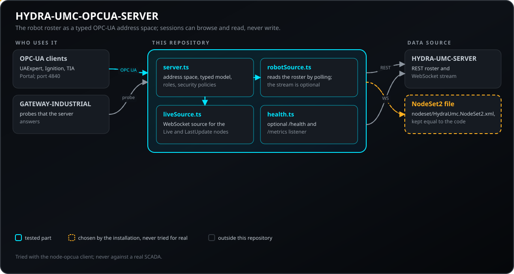
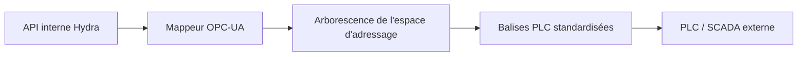
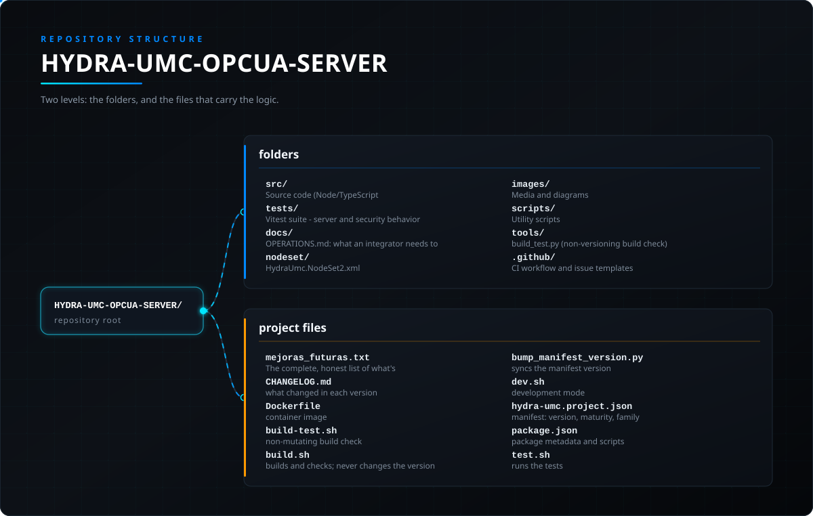

<!-- =============================================================================
HYDRA-UMC-OPCUA-SERVER - OPC-UA address space of the robot roster
Copyright (C) JuanenRac (Electro Hobby 3D) <electrohobby3d@gmail.com>
GPL-3.0-or-later - see LICENSE
============================================================================= -->

<p align="center">
  
</p>

# 🏭 HYDRA-UMC-OPCUA-SERVER

<p align="center"><a href="README.md">🇺🇸 English</a> | <a href="README_spa.md">🇪🇸 Español</a> | 🇫🇷 <b>Français</b> | <a href="README_ita.md">🇮🇹 Italiano</a> | <a href="README_deu.md">🇩🇪 Deutsch</a> | <a href="README_zho.md">🇨🇳 简体中文</a> | <a href="README_jpn.md">🇯🇵 日本語</a> | <a href="README_por.md">🇵🇹 Português</a></p>

### 🛠️ Mappage des objets HydraState vers des espaces d'adressage OPC-UA standardisés

<p align="center">
  
  
  
  
  
  
</p>

---

**Vérification d'honnêteté - ce qui fonctionne réellement aujourd'hui :** le serveur OPC-UA et le mappage de l'espace d'adressage (`src/server.ts`) sont réels et testés (136 tests passants entre `tests/server.test.ts`, `tests/security.test.ts`, `tests/security-policy.test.ts`, `tests/robotSource.test.ts`, `tests/robotSource.integration.test.ts`) - et ce sont de vrais tests au niveau du protocole : `tests/server.test.ts` connecte un vrai `OPCUAClient` (le propre client de node-opcua, la même bibliothèque qu'utiliseraient UAExpert/Ignition) via le vrai protocole binaire sur un vrai port TCP, et `tests/security-policy.test.ts` prouve qu'une session non chiffrée `SecurityPolicy.None` est authentiquement refusée par défaut (acceptée uniquement via l'échappatoire explicite `OPCUA_ALLOW_INSECURE=1`). Ce qui est délibérément différé, pas une lacune trouvée par accident : l'arbre par robot (`Robot_<id>`) suit la liste que rapporte HYDRA-UMC-SERVER (interrogée avec un jeton ou un compte, voir `.env.example`), mais le reste de l'espace d'adressage est construit une seule fois au démarrage ; seules les lectures/écritures sont testées de bout en bout pour l'instant, pas les abonnements OPC-UA ; et le Pub/Sub (Phase 1 de la feuille de route) reste non implémenté, car aucun client n'en dépend encore. Voir `mejoras_futuras.txt` pour la liste complète de ce qui est différé et pourquoi, et `CHANGELOG.md` pour ce qui a été livré exactement jusqu'à présent.

---

> **État de la sûreté et de la cybersécurité :** cet écosystème n'est pas un système de sécurité certifié. Il n'existe pas encore de chaîne d'E-STOP matérielle, ni de limites ou de verrouillages imposés par le firmware, ni de commande de mouvement vérifiée ; les images de firmware sont contrôlées par CRC-32 et une signature Ed25519, et une compilation de version refuse les clés de développement publiées (les têtes d'outil et les cartes d'extension derrière le relais utilisent encore les chargeurs d'URTC, qui prennent un HMAC-SHA256 à clé partagée au lieu d'une signature) ; TLS et TLS mutuel sont optionnels et désactivés par défaut ; aucune carte propre n'a encore été assemblée ni testée. Lisez la [base de sécurité](https://github.com/JuanenRac/HYDRA-UMC-DOCS/blob/main/docs/SECURITY_BASELINE.md) et le [modèle de menaces](https://github.com/JuanenRac/HYDRA-UMC-DOCS/blob/main/docs/THREAT_MODEL.md) avant de vous fier à une affirmation d'ici pour la sécurité d'une personne.

---

## 📋 En un coup d'œil

| | |
|---|---|
| Version | `0.2.2` |
| Maturité | Fonctionnel |
| Tests | 136 (`npm test`) |
| Technologie | Node.js / node-opcua / OPC-UA address space |
| Cible | Le Raspberry Pi CM5 d'une cellule HYDRA-UMC |
| Sur matériel réel | Pas encore : aucune exécution sur du matériel réel n'est consignée pour cette version |

**Aller à :** [Présentation](#-présentation) · [Architecture](#-architecture) · [Configuration](#-configuration) · [Démarrage rapide](#-démarrage-rapide) · [Tests](#-tests) · [Structure du dépôt](#-structure-du-dépôt) · [Projets liés](#-projets-liés)

## 🚦 État du projet

Chaque ligne est une partie de ce dépôt et le feu dit où elle en est aujourd'hui. Elle est écrite d'après ce que le dépôt peut montrer (tests, compilations, exécutions), pas d'après ce qui est prévu.

🟢 Fait et vérifié · 🟡 Fonctionne, avec des limites connues · 🟠 À moitié fait ou pas encore vérifié · 🔴 Pas fait ou ne fonctionne pas

| Domaine | État | Ce que cela veut dire ici |
|---|---|---|
| Logiciel | 🟡 | Fonctionne pour son usage principal ; la vérification d'honnêteté ci-dessus liste ce qui manque encore |
| Tests | 🟢 | 136 tests automatiques, exécutés à chaque modification |
| Matériel réel | 🔴 | Pas encore : aucune exécution sur du matériel réel n'est consignée pour cette version |
| Documentation | 🟢 | README en huit langues, vérifié par rapport au manifeste à chaque modification |

## 🎯 Présentation

**HYDRA-UMC-OPCUA-SERVER** est le module de modélisation industrielle central de la passerelle (Gateway). Il traduit l'HydraState interne et dynamique (JSON) en un espace d'adressage OPC-UA structuré et découvrable.

Il permet aux logiciels d'automatisation industrielle (comme Ignition, Siemens TIA Portal ou Rockwell FactoryTalk) de parcourir, lire et écrire dans les variables robotiques comme s'il s'agissait de balises (tags) PLC standard.

### Caractéristiques principales :
* 🛠️ **Modélisation dynamique des informations :** Génère automatiquement l'arborescence OPC-UA en fonction des robots et des outils actifs.
* 🔄 **Liste des robots et deux indicateurs :** la liste des robots (objets `Robot_<id>` avec `Name` et `Online`) est en lecture seule ; `SwarmOnline` et `MaintenanceMode` sont aussi en lecture seule (une écriture n'aurait aucun effet sur le reste du système et est refusée) ; `SwarmOnline` vaut `BadWaitingForInitialData` tant que l'interrogation de la liste n'a pas lu une fois. Aucun nœud ne commande une articulation ni un effecteur.
* 🧭 **Modèle typé, rôles et signal en direct :** la cellule est un `HydraCellType` et chaque robot un `HydraRobotType` sous un dossier `Objects/Robots` (les NodeId, dans l'espace de noms 1, ne changent pas ; le modèle est le fichier `nodeset/HydraUmc.NodeSet2.xml`, qu'un test garde identique au code). `Online` n'est que l'interrupteur de l'interface de l'opérateur ; `Live` dit si le robot a envoyé un correctif à HYDRA-UMC-SERVER dans `HYDRA_UMC_OPCUA_LIVE_WINDOW_MS` et `LastUpdate` quand, ce qui demande `HYDRA_UMC_OPCUA_SOURCE=stream` (un WebSocket au lieu de l'interrogation) et vaut sinon `BadWaitingForInitialData`. Les sessions ont des rôles OPC UA : anonyme est `Anonymous`, le lecteur un `Observer`, l'administrateur aussi `ConfigureAdmin` ; aucun rôle ne peut écrire. *(essayé avec le client de node-opcua, jamais avec un SCADA)*
* 🔖 **Espace de noms versionné & NodeIds stables :** Une URI d'espace de noms réelle et explicite, ainsi que des NodeIds de type chaîne explicites - une mise à jour de l'espace d'adressage ne peut pas changer silencieusement le chemin dont dépend un client. *(implémenté)*
* 🔐 **Autorisation d'écriture par session :** Une vérification réelle et dynamique distinguant une session anonyme d'une session authentifiée - tous les clients n'obtiennent pas un accès en écriture par défaut. *(implémenté)*
* 📡 **Prise en charge des abonnements :** Mises à jour des données haute efficacité à l'aide des mécanismes de publication-abonnement OPC-UA. *(testé de bout en bout : un vrai abonnement livre une notification de changement de données)*
* 🩺 **Exploitation (tout est optionnel) :** `OPCUA_HEALTH_PORT` ouvre un écouteur séparé (en boucle locale sauf si `OPCUA_HEALTH_HOST` dit autre chose) avec `GET /health` et `GET /metrics` (sessions, abonnements, connexions échouées, robots, lisibilité de la liste) ; tant que la liste n'est pas lisible, les variables `Online` des robots valent `false` avec une qualité Uncertain au lieu d'un simple `false` ; `OPCUA_VIEWER_USERNAME`/`OPCUA_VIEWER_PASSWORD` ajoutent un compte en lecture seule et `OPCUA_ALLOW_ANONYMOUS=0` refuse les sessions anonymes ; les réglages de la liste acceptent aussi les noms `HYDRA_UMC_SERVER_*` communs à l'écosystème. Tout est désactivé ou inchangé par défaut. *(implémenté)*
* 🛡️ **Cryptage :** chaque vraie session exige Signed ou Signed+Encrypted (Basic256Sha256, Aes128_Sha256_RsaOaep ou Aes256_Sha256_RsaPss) - une connexion non chiffrée `SecurityPolicy.None` est réellement refusée, pas seulement déconseillée.

## 🧩 Rôle dans HYDRA-UMC

**HYDRA-UMC-OPCUA-SERVER** publie la liste des robots de `HYDRA-UMC-SERVER` comme un espace d'adressage OPC-UA que les logiciels SCADA et d'automatisation peuvent parcourir. Les sessions portent des rôles OPC UA et aucun rôle ne peut écrire : aucun nœud ne commande une articulation ni un effecteur.

## 🏛️ Architecture

<p align="center">
  
</p>

<details>
<summary>Version texte du diagramme (Mermaid)</summary>



</details>

### ARCHITECTURE & DÉCISIONS DE CONCEPTION

* **Pourquoi c'est un frère, pas un sous-module, de HYDRA-UMC-GATEWAY-INDUSTRIAL.** Chaque adaptateur de protocole est un processus déployable/redémarrable séparément - un problème dans la bibliothèque cliente OPC-UA ne fait jamais tomber les adaptateurs MQTT ou MTConnect qui tournent à côté.
* **Pourquoi un espace d'adressage OPC-UA, pas un simple passthrough REST.** Les clients OPC-UA (SCADA/historiens) attendent un vrai espace d'adressage navigable avec des nœuds typés - un passthrough REST plat exposerait techniquement les données mais viderait de son sens le fait de parler OPC-UA.
* **Comment cela s'intègre dans le reste de l'écosystème.** Un service frère sous HYDRA-UMC-GATEWAY-INDUSTRIAL - traduit le propre état de HYDRA-UMC-SERVER en un vrai espace d'adressage OPC-UA.
* **Des tests réels au niveau du protocole, pas seulement une vérification de compilation.** `tests/server.test.ts` connecte un vrai `OPCUAClient` (le client propre de node-opcua, la même bibliothèque qu'utiliseraient UAExpert/Ignition) à un vrai `OPCUAServer` via le vrai protocole binaire sur un vrai port TCP - ouverture d'une session, parcours/lecture de `SwarmOnline`/`ActiveRobotCount` par chemin, et confirmation qu'une écriture émise par le client se reflète à la fois dans la valeur relue et dans l'état interne du serveur.
* **Pourquoi des NodeIds de type chaîne explicites, et non les NodeIds numériques auto-assignés de node-opcua.** Un NodeId numérique est attribué selon l'ordre de création - insérer un nouveau DataItem avant un DataItem existant dans le code le renumérote silencieusement, cassant tout client industriel ayant codé en dur l'ancien numéro. Un NodeId explicite au format `s=HydraNode_1.SwarmOnline` ne peut jamais se déplacer sous un client simplement parce que le code de l'espace d'adressage a changé de forme.
* **Pourquoi `SpindleTemp` utilise `timestamped_get`, et non le `get()` plus simple utilisé par les autres variables.** `get()` horodate automatiquement chaque lecture avec l'heure actuelle - adapté à une valeur en direct, malhonnête pour une valeur qui évolue lentement (une broche ne se réchauffe pas entre deux interrogations). `timestamped_get` renvoie un vrai `DataValue` avec un `sourceTimestamp` explicite qui suit le moment où la valeur a réellement changé pour la dernière fois, la sémantique réelle sur laquelle s'appuie un historien OPC-UA.
* **Ce qui se passe quand la source réelle de `SpindleTemp` se déconnecte.** La dernière vraie valeur continue d'être servie - jamais masquée, jamais réinitialisée - mais son `statusCode` passe de `Good` au code réel et standard de node-opcua `UncertainLastUsableValue` ("Whatever was updating this value has stopped doing so"), et `sourceTimestamp` continue de pointer vers l'instant réel de la dernière observation, jamais "maintenant". Une session correctement authentifiée et chiffrée ne change jamais cela - elle authentifie le client, pas la fraîcheur de la donnée.
* **Pourquoi l'autorisation d'écriture est par session (`isUserWritable`), et non un indicateur statique de niveau d'accès.** Un `userAccessLevel` statique ne peut pas distinguer la session d'un client de celle d'un autre - il est identique pour chaque connexion. Surcharger `isUserWritable(context)` sur le nœud variable est le mécanisme propre et documenté de node-opcua pour une vérification qui varie réellement par session, assez réelle pour être testée avec deux identités de client réelles différentes.

Délibérément reporté, et pourquoi : un espace d'adressage entièrement dynamique (l'arbre par robot suit déjà la liste que rapporte HYDRA-UMC-SERVER ; le reste est construit une fois au démarrage) ; et le point Pub/Sub de la feuille de route (toujours non implémenté - aucun client n'en dépend pour l'instant).

## ⚙️ Configuration

Le port d'écoute est lu d'abord dans `HYDRA_UMC_OPCUA_PORT` (4840 par défaut). Le `PORT` partagé reste valable en dernier recours et affiche un avertissement, de sorte qu'un fichier d'environnement partagé par plusieurs services ne puisse pas déplacer le serveur sur le port d'un autre service par accident ; une valeur définie mais qui n'est pas un port valide arrête le démarrage, et le contrôle de santé du conteneur suit le même ordre. L'accès historique est désactivé par défaut. `HYDRA_UMC_OPCUA_HISTORY=1` l'active, `HYDRA_UMC_OPCUA_HISTORY_URL` désigne HYDRA-UMC-DATALAKE (avec `HYDRA_UMC_OPCUA_HISTORY_TOKEN` s'il a un jeton de lecture) et `HYDRA_UMC_OPCUA_HISTORY_MAP` est un fichier JSON qui associe des variables à des séries ; seules les variables associées répondent à un HistoryRead, les sessions anonymes sont refusées sauf avec `HYDRA_UMC_OPCUA_HISTORY_ANONYMOUS=1`, et une lecture prend au plus `HYDRA_UMC_OPCUA_HISTORY_MAX_POINTS` points (10000 par défaut). Rien ne devient inscriptible. L'historique traité est lui aussi désactivé par défaut : `HYDRA_UMC_OPCUA_HISTORY_AGGREGATES=1` lui fait répondre Average, Minimum, Maximum, Count et Interpolative (au plus `HYDRA_UMC_OPCUA_HISTORY_MAX_INTERVALS` intervalles par lecture, 1000 par défaut), et `HYDRA_UMC_OPCUA_HISTORY_EVENTS=1` avec `HYDRA_UMC_OPCUA_HISTORY_EVENTS_MAP` (un fichier JSON de règles de limites par objet) lui fait répondre l'historique des événements dérivé des séries stockées.

## 🚀 Démarrage rapide

Nécessite Node.js 20 ou plus récent avec npm.

```bash
npm install
npm test
npm run build
npm start
```

## 🧪 Tests

136 tests automatiques s'exécutent avec `npm test`. Ils n'ont besoin ni de matériel ni de rien en dehors de cette machine.

La CI exécute `HYDRA_UMC_CI=1 python tools/ci_validate.py`, qui vérifie le manifeste, les documents, les huit README et les images.

## 🏗️ Compilation et publication

### Prérequis
- [Node.js](https://nodejs.org/) (v20 ou supérieur recommandé)
- npm

### Installation
```bash
npm install
```

### Mode Développement
Exécute le serveur OPC-UA directement avec `tsx` (sans bundler) :
- **Windows :** double-cliquer sur `dev.bat` ou exécuter `npm run dev`
- **Linux/Mac :** exécuter `./dev.sh` ou `npm run dev`

### Build de Production
Regroupe le serveur en un seul fichier déployable avec esbuild :
- **Windows :** double-cliquer sur `build.bat` ou exécuter `npm run build`
- **Linux/Mac :** exécuter `./build.sh` ou `npm run build`

Puis démarrez-le avec :
```bash
npm start
```

Le serveur écoute sur `0.0.0.0:4840` (le port OPC-UA par défaut enregistré
par l'IANA) à l'endpoint `opc.tcp://<host>:4840/HYDRA-UMC-OPCUA-SERVER` -
pointez n'importe quel client OPC-UA (UAExpert, Ignition, Siemens TIA
Portal, ...) pour parcourir l'espace d'adressage.

### Gestion des versions
`npm run build` ne fait que regrouper le serveur. La version n'est augmentée que par `python tools/hydra_project_tool.py bump` (via `bump_manifest_version.py`), un « compteur kilométrique » en base 10 : patch +1 par bump, avec report sur minor (et de minor sur major) après 9 au lieu d'atteindre un segment à deux chiffres (`0.0.9` -> `0.1.0`, pas `0.0.10`).

## 📂 Structure du dépôt

<p align="center">
  
</p>

<details>
<summary>Version texte de l'arborescence</summary>

```text
HYDRA-UMC-OPCUA-SERVER/
├── src/                       Code source (Node/TypeScript - Modèle, Serveur, Mappeur)
├── tests/                     Suite Vitest - comportement serveur et sécurité
├── docs/                      OPERATIONS.md : ce dont un intégrateur a besoin pour exécuter, joindre et exposer en sécurité ce serveur
├── nodeset/                   HydraUmc.NodeSet2.xml : le modèle d'information de l'espace de noms en fichier NodeSet2 (scripts/export_nodeset.ts l'écrit et le vérifie)
├── images/                    Médias et diagrammes
├── scripts/                   Scripts utilitaires (bump-version.mjs, export_nodeset.ts)
├── tools/                     build_test.py (contrôle de build sans version), ci_validate.py (validation manifeste/CHANGELOG/docs utilisée par la CI), hydra_project_tool.py et les partagés _doc_policy.py et _readme_parity.py
├── .github/                   workflow de CI et modèles de tickets
├── mejoras_futuras.txt        La liste complète et honnête de ce qui est délibérément reporté, et pourquoi
├── CHANGELOG.md               ce qui a changé à chaque version
├── Dockerfile                 image de conteneur
├── build-test.sh              vérification de build sans modification
├── build.sh                   construit et vérifie ; ne change jamais la version
├── bump_manifest_version.py   synchronise la version du manifeste
├── dev.sh                     mode développement
├── hydra-umc.project.json     manifeste : version, maturité, famille
├── package.json               métadonnées et scripts du paquet
└── test.sh                    lance les tests
```

</details>

## 🗺️ Feuille de route et limites connues

**Limites connues aujourd'hui**

* **Phase 1 :** Implémentation d'OPC-UA Pub/Sub pour l'échange de données à haute vitesse et le pontage des protocoles hérités.
* **Phase 2 :** le broker MQTT existe déjà comme dépôt à part ([HYDRA-UMC-MQTT-BROKER](https://github.com/JuanenRac/HYDRA-UMC-MQTT-BROKER)) ; le cluster pour la gestion massive des appareils IoT et la haute simultanéité reste prévu.
* **Phase 3 :** l'adaptateur MTConnect existe déjà comme dépôt à part ([HYDRA-UMC-MTCONNECT-ADAPTER](https://github.com/JuanenRac/HYDRA-UMC-MTCONNECT-ADAPTER)) ; l'intégration de machines CNC et d'automates multi-fournisseurs au-delà reste prévue.
* **Phase 4 :** Conformité totale avec la spécification compagnon OPC UA Robotics et synchronisation de la passerelle industrielle.

## 🌍 Langues

Ce README et les documents du dépôt existent en huit langues : anglais, espagnol, allemand, français, italien, japonais, chinois et portugais (Portugal). Ils sont écrits ensemble et la CI vérifie que les huit fichiers ont les mêmes sections et les mêmes liens. Ce dépôt n'a ni écran ni catalogue de messages propre, il n'y a donc aucune chaîne d'interface à traduire.

## 🔗 Projets liés

Ce projet fait partie de l'écosystème robotique HYDRA-UMC du même auteur (JuanenRac / Electro Hobby 3D). Bon à savoir, car une demande pourrait en réalité concerner l'un de ceux-ci plutôt que ce dépôt.

**Projet Parent**
- **[HYDRA-UMC-GATEWAY-INDUSTRIAL](https://github.com/JuanenRac/HYDRA-UMC-GATEWAY-INDUSTRIAL)** — hub d'intégration relayant vers les protocoles industriels, avec une vraie couche de liste blanche de commandes/contre-pression ; le parent dont ce dépôt est un adaptateur de protocole spécifique, au sein de sa propre passerelle industrielle.

**Projets Frères** — les autres adaptateurs de protocole de la propre passerelle industrielle de HYDRA-UMC-GATEWAY-INDUSTRIAL
- **[HYDRA-UMC-MQTT-BROKER](https://github.com/JuanenRac/HYDRA-UMC-MQTT-BROKER)** — vrai broker MQTT avec authentification par client optionnelle et ACL de sujets.
- **[HYDRA-UMC-MTCONNECT-ADAPTER](https://github.com/JuanenRac/HYDRA-UMC-MTCONNECT-ADAPTER)** — vrais points de terminaison XML MTConnect `/probe` et `/current`, avec sortie en mode dégradé.

**Directement Liés**
- **[HYDRA-UMC-SERVER](https://github.com/JuanenRac/HYDRA-UMC-SERVER)** — le vrai backend headless (REST/WebSocket) auquel parle réellement chaque client de contrôle — la source de l'état que cet adaptateur expose.

**Fait Également Partie de l'Écosystème**

*Matériel & Plateforme de Base*
- **[HYDRA-UMC](https://github.com/JuanenRac/HYDRA-UMC)** — la conception de la carte mère du bras robotique : hôte CM5 + coprocesseur STM32H745 double cœur, destinée à coordonner jusqu'à 8 bras-outils via CAN-OTA/SPI-OTA (firmware à un stade précoce ; aucune carte assemblée pour l'instant).
- **[HYDRA-UMC-OS](https://github.com/JuanenRac/HYDRA-UMC-OS)** — couche produit reproductible sur Raspberry Pi OS pour le CM5 : agent en lecture seule, config/profils validés, provisionnement WiFi de premier contact.
- **[HYDRA-UMC-SDK](https://github.com/JuanenRac/HYDRA-UMC-SDK)** — le contrat JSON-Schema partagé et la barrière logicielle de contrôle des jobs contre laquelle chaque bridge valide ses commandes (pas une fonction de sécurité certifiée).
- **[HYDRA-UMC-CONNECTOR-HUB](https://github.com/JuanenRac/HYDRA-UMC-CONNECTOR-HUB)** — registre déclaratif et validateur de manifestes d'adaptateur pour les connecteurs de machines externes ; étend la propre idée de contrat du SDK aux machines externes sans remplacer les projets de passerelle industrielle.

*Backend Central & Clients*
- **[HYDRA-UMC-STUDIO](https://github.com/JuanenRac/HYDRA-UMC-STUDIO)** — tableau de bord de contrôle web avec visualisation 3D multi-robot en temps réel.
- **[HYDRA-UMC-SUITE](https://github.com/JuanenRac/HYDRA-UMC-SUITE)** — centre de commande d'essaim de bureau (PySide6) pour plusieurs serveurs à la fois, empaqueté en exécutable autonome.
- **[HYDRA-UMC-ANDROID-CONTROL](https://github.com/JuanenRac/HYDRA-UMC-ANDROID-CONTROL)** — application de contrôle Android native avec connexion biométrique et un compagnon Wear OS jumelé.
- **[HYDRA-UMC-IOS-CONTROL](https://github.com/JuanenRac/HYDRA-UMC-IOS-CONTROL)** — application de contrôle iOS/iPadOS (Flutter) avec synchronisation WebSocket en temps réel.
- **[HYDRA-UMC-DSI](https://github.com/JuanenRac/HYDRA-UMC-DSI)** — interface tactile native pour l'écran tactile DSI 7" embarqué, intégrée directement sur le CM5.
- **[HYDRA-UMC-EDITOR-URDF](https://github.com/JuanenRac/HYDRA-UMC-EDITOR-URDF)** — créateur/éditeur graphique de bureau pour URDF qui envoie les modèles terminés vers le propre catalogue de STUDIO.
- **[HYDRA-UMC-EDITOR-STL](https://github.com/JuanenRac/HYDRA-UMC-EDITOR-STL)** — éditeur de bureau de modèles STL, transformant/remplaçant/retirant/ajoutant de vraies pièces dans le même catalogue de modèles qu'édite aussi HYDRA-UMC-EDITOR-URDF.
- **[HYDRA-UMC-BRIDGE-AMR](https://github.com/JuanenRac/HYDRA-UMC-BRIDGE-AMR)** — frontière de coordination pour les flottes AGV/AMR via un éditeur MQTT VDA 5050 (testé uniquement contre une flotte émulée).
- **[HYDRA-UMC-BRIDGE-CNC](https://github.com/JuanenRac/HYDRA-UMC-BRIDGE-CNC)** — coordinateur haut niveau pour cellules CNC avec accès au statut/octets de contrôle GRBL (testé uniquement contre un émulateur).
- **[HYDRA-UMC-BRIDGE-DROIDS](https://github.com/JuanenRac/HYDRA-UMC-BRIDGE-DROIDS)** — frontière de coordination pour droïdes à pattes/humanoïdes, avec un émetteur de commandes Boston Dynamics Spot (testé uniquement contre un émulateur).
- **[HYDRA-UMC-BRIDGE-LASER](https://github.com/JuanenRac/HYDRA-UMC-BRIDGE-LASER)** — coordinateur de cellules laser lisant 3 signaux GPIO de clé/enceinte/verrouillage (testé uniquement contre une puce simulée ; il ne peut ni armer ni tirer un laser).
- **[HYDRA-UMC-BRIDGE-OPENPNP](https://github.com/JuanenRac/HYDRA-UMC-BRIDGE-OPENPNP)** — coordinateur haut niveau sûr pour le flux de cartes du pick-and-place OpenPnP.
- **[HYDRA-UMC-BRIDGE-PRINTER3D](https://github.com/JuanenRac/HYDRA-UMC-BRIDGE-PRINTER3D)** — frontière de coordination sûre pour imprimantes 3D Moonraker/Klipper, avec de vraies commandes de tâche contrôlées.
- **[HYDRA-UMC-BRIDGE-ROS2](https://github.com/JuanenRac/HYDRA-UMC-BRIDGE-ROS2)** — coordinateur avec un transport ROS 2 rclpy à importation paresseuse (pas encore exécuté contre une installation ROS 2).
- **[HYDRA-UMC-BRIDGE-UAV](https://github.com/JuanenRac/HYDRA-UMC-BRIDGE-UAV)** — frontière de coordination pour UAV équipés de caméra, avec un émetteur de commandes MAVLink (testé uniquement contre un émulateur).

*Plateforme d'Outils URTC*
- **[URTC](https://github.com/JuanenRac/URTC)** — firmware pour la carte physique Universal Robot Tool Controller, plus de 25 profils d'outil sur bus CAN.
- **[URTC-FLASHER](https://github.com/JuanenRac/URTC-FLASHER)** — outil de bureau à interface graphique pour flasher les cartes URTC, CAN-OTA plus SWD/JTAG puce complète.
- **[URTC-TESTER](https://github.com/JuanenRac/URTC-TESTER)** — outil de bureau de diagnostic CAN-bus en direct pour cartes URTC, un panneau par profil d'outil.
- **[URTC-WEB-STUDIO](https://github.com/JuanenRac/URTC-WEB-STUDIO)** — alternative basée navigateur à URTC-TESTER via la Web Serial API, sans installation locale.
- **[URTC-GATEWAY](https://github.com/JuanenRac/URTC-GATEWAY)** — passerelle devant le bus CAN d'URTC : liste d'identifiants autorisés, limite de débit et clé de session ; logiciel testé sur ordinateur, pas encore sur un bus réel.

*Nœud IA de Vision (Hailo-8)*
- **[HYDRA-UMC-VISION-NODE](https://github.com/JuanenRac/HYDRA-UMC-VISION-NODE)** — hub d'intégration pour le pipeline de vision Hailo-8, avec une vraie vérification de disponibilité matérielle par étape.
- **[HYDRA-UMC-DETECTION-HEF](https://github.com/JuanenRac/HYDRA-UMC-DETECTION-HEF)** — registre réel de modèles compilés avec vérification de chargement sécurisé par architecture Hailo/checksum.
- **[HYDRA-UMC-VISION-STREAMER](https://github.com/JuanenRac/HYDRA-UMC-VISION-STREAMER)** — générateur réel de pipeline GStreamer + config MediaMTX, avec une vraie frontière d'intégration HailoRT.
- **[HYDRA-UMC-VISUAL-SERVOING-API](https://github.com/JuanenRac/HYDRA-UMC-VISUAL-SERVOING-API)** — loi de correction Position-Based Visual Servoing avec autorisation conditionnée à l'état de zone ; pas encore d'estimation de pose par caméra.
- **[HYDRA-UMC-SAFETY-ZONES](https://github.com/JuanenRac/HYDRA-UMC-SAFETY-ZONES)** — logique v0 de violation de zone, de fraîcheur de calibration et de demande d'E-STOP qui lit les positions d'objets dans un fichier ; aucun détecteur ne l'alimente et aucun E-STOP physique n'y est encore relié.

*Nœud IA Cognitif (Hailo-10)*
- **[HYDRA-UMC-COGNITIVE-NODE](https://github.com/JuanenRac/HYDRA-UMC-COGNITIVE-NODE)** — hub d'intégration pour le pipeline cognitif Hailo-10 (orchestration LLM/VLA/voix).
- **[HYDRA-UMC-VLA-ENGINE](https://github.com/JuanenRac/HYDRA-UMC-VLA-ENGINE)** — vrai encodage/décodage de jetons d'action et génération de trajectoire pour un modèle Vision-Language-Action.
- **[HYDRA-UMC-VOICE-UI](https://github.com/JuanenRac/HYDRA-UMC-VOICE-UI)** — vrai front-end vocal (VAD + analyseur d'intention) avec un relais Watch borné et soumis à confirmation.
- **[HYDRA-UMC-SEMANTIC-PLANNER](https://github.com/JuanenRac/HYDRA-UMC-SEMANTIC-PLANNER)** — vraie décomposition de tâches basée sur des règles et récupération sémantique d'erreurs sur les codes d'erreur MCU.
- **[HYDRA-UMC-DOCS-QA](https://github.com/JuanenRac/HYDRA-UMC-DOCS-QA)** — vraie recherche documentaire TF-IDF (bibliothèque standard uniquement) sur les propres documents Markdown de cet écosystème.
- **[HYDRA-UMC-LOCAL-TECHNICIAN](https://github.com/JuanenRac/HYDRA-UMC-LOCAL-TECHNICIAN)** — technicien de maintenance IA local et à portes de politique pour l'écosystème lui-même - observe, diagnostique et propose des corrections ; les deux niveaux de risque les plus élevés ne sont délibérément pas encore implémentés.

*Orchestration & Essaim*
- **[HYDRA-UMC-ORCHESTRATOR](https://github.com/JuanenRac/HYDRA-UMC-ORCHESTRATOR)** — hub d'intégration avec un vrai contrat de rapport de santé gRPC/Protobuf et une machine à états de mission.
- **[HYDRA-UMC-JOB-DISPATCHER](https://github.com/JuanenRac/HYDRA-UMC-JOB-DISPATCHER)** — vraie file de tâches basée sur la priorité avec déduplication, via une vraie API HTTP.
- **[HYDRA-UMC-NODE-HEALING](https://github.com/JuanenRac/HYDRA-UMC-NODE-HEALING)** — vrai chien de garde de santé de flotte basé sur gRPC, avec retry/backoff et détection d'incohérence d'identité.
- **[HYDRA-UMC-PATH-PLANNER-3D](https://github.com/JuanenRac/HYDRA-UMC-PATH-PLANNER-3D)** — vrai planificateur de trajectoire 3D basé sur RRT, avec vraie validation des collisions obstacle/espace de travail.
- **[HYDRA-UMC-SWARM-SYNC](https://github.com/JuanenRac/HYDRA-UMC-SWARM-SYNC)** — vraie synchronisation d'état CRDT LWW-Element-Map, testée par propriétés pour la convergence multi-cellule.

*Jumeau Numérique & Simulation*
- **[HYDRA-UMC-TWIN](https://github.com/JuanenRac/HYDRA-UMC-TWIN)** — hub d'intégration pour le moteur de jumeau numérique, avec un vrai contrat de synchronisation par compatibilité de version.
- **[HYDRA-UMC-HIL-BRIDGE](https://github.com/JuanenRac/HYDRA-UMC-HIL-BRIDGE)** — routeur hardware-in-the-loop avec un verrouillage logiciel de collision entre simulation et matériel réel (testé sans matériel réel).
- **[HYDRA-UMC-PHYSICS-REPLICA](https://github.com/JuanenRac/HYDRA-UMC-PHYSICS-REPLICA)** — vraie cinématique directe et validation des limites articulaires sur un vrai sous-ensemble URDF.
- **[HYDRA-UMC-SYNTHETIC-DATA-GEN](https://github.com/JuanenRac/HYDRA-UMC-SYNTHETIC-DATA-GEN)** — vrai générateur procédural de scènes 2D avec export d'annotations YOLO/COCO.

*Données & Analytique*
- **[HYDRA-UMC-DATALAKE](https://github.com/JuanenRac/HYDRA-UMC-DATALAKE)** — vrai magasin de séries temporelles basé sur sqlite3, avec une vraie API HTTP d'ingestion/requête.
- **[HYDRA-UMC-ANOMALY-DETECTOR](https://github.com/JuanenRac/HYDRA-UMC-ANOMALY-DETECTOR)** — vrai détecteur d'anomalies FFT + ligne de base statistique, avec surveillance de dérive.
- **[HYDRA-UMC-PRODUCTION-REPORTS](https://github.com/JuanenRac/HYDRA-UMC-PRODUCTION-REPORTS)** — vrai calcul OEE/disponibilité sur l'historique de DATALAKE, avec export CSV reproductible.
- **[HYDRA-UMC-TELEMETRY-COLLECTOR](https://github.com/JuanenRac/HYDRA-UMC-TELEMETRY-COLLECTOR)** — vrai pipeline d'ingestion CAN/WebSocket vers DATALAKE, avec déduplication par séquence.

*Outils Complémentaires & Opérations de l'Écosystème*
- **[HYDRA-UMC-DASHBOARD-AI](https://github.com/JuanenRac/HYDRA-UMC-DASHBOARD-AI)** — panneaux Smart Summaries et Anomaly Highlighting sur DATALAKE/ANOMALY-DETECTOR, avec un repli statistique honnête.
- **[HYDRA-UMC-TOOL-CLI](https://github.com/JuanenRac/HYDRA-UMC-TOOL-CLI)** — CLI de flotte avec un vrai contrat de codes de sortie stable, un vrai client en direct de la propre API de HYDRA-UMC-SERVER.
- **[HYDRA-UMC-WATCH](https://github.com/JuanenRac/HYDRA-UMC-WATCH)** — application compagnon WearOS avec des motifs d'alerte haptique et un relais vocal vers le téléphone jumelé (pas encore exécutée sur une montre physique).
- **[URTC-SMART-RACK](https://github.com/JuanenRac/URTC-SMART-RACK)** — firmware pour un rack de montage de cartes avec décodage réel d'ID d'outil et logique de préchauffage Smart Idle.
- **[URTC-VISION-TOOL](https://github.com/JuanenRac/URTC-VISION-TOOL)** — firmware plus un vrai compagnon de vision Python pour une tête d'outil d'inspection thermique/RGB.
- **[HYDRA-UMC-UPDATER](https://github.com/JuanenRac/HYDRA-UMC-UPDATER)** — outil administratif de bureau qui découvre, clone et met à jour chaque dépôt de cet écosystème.
- **[HYDRA-UMC-OS-REBUILDER](https://github.com/JuanenRac/HYDRA-UMC-OS-REBUILDER)** — outil de bureau Windows/Linux qui construit une image de la CM5 prête à graver, préchargée avec les versions les plus actuelles de l'écosystème, avec une configuration de premier démarrage Wi-Fi/utilisateur/SSH façon Raspberry Pi Imager.
- **[HYDRA-UMC-OPS-AGENT](https://github.com/JuanenRac/HYDRA-UMC-OPS-AGENT)** — coordinateur d'incidents de maintenance : un rôle edge à faible privilège collecte un instantané d'inventaire/santé assaini, un rôle control-plane le rend en lecture seule et demande à un fournisseur d'IA de suggérer un diagnostic - n'applique jamais de correctif ni ne déploie rien.
- **[HYDRA-UMC-DEV-SERVER](https://github.com/JuanenRac/HYDRA-UMC-DEV-SERVER)** — hôte de développement reproductible (Raspberry Pi 5 / CM5) qui héberge le code source de l'écosystème et exécute des tâches de compilation/test délimitées via une file d'attente durable ; un rôle de développement dédié, explicitement distinct d'un CM5 opérationnel.

## 📚 Documentation

Où lire la suite :

* [Base de sécurité de l'écosystème](https://github.com/JuanenRac/HYDRA-UMC-DOCS/blob/main/docs/SECURITY_BASELINE.md)
* [Modèle de menaces de l'écosystème](https://github.com/JuanenRac/HYDRA-UMC-DOCS/blob/main/docs/THREAT_MODEL.md)
* [Journal des modifications de ce dépôt](CHANGELOG.md)
* [Licence de ce dépôt](LICENSE.md)

## 🤝 Contribuer et communauté

* Avant une pull request, exécutez `HYDRA_UMC_CI=1 py -3 tools/ci_validate.py` (ou `HYDRA_UMC_CI=1 python3 tools/ci_validate.py`) : il doit afficher `CI_VALIDATION=PASS`. N'exécutez pas `build.sh` ni `build.bat` pour cette vérification ; compiler n'est pas vérifier.
* Les huit README sont écrits à partir d'une source unique dans HYDRA-UMC-DOCS ; ne les modifiez pas à la main. Changez la source et réécrivez-les avec `tools/make_readmes.py`.
* N'affirmez pas dans un README ce qui n'a pas tourné : écrivez « simulé » ou « non essayé sur matériel » quand c'est la vérité.
* Voir [CONTRIBUTING.md](CONTRIBUTING.md), le [code de conduite](CODE_OF_CONDUCT.md), [SECURITY.md](SECURITY.md) et [SUPPORT.md](SUPPORT.md).

## 👤 AUTEUR

**JuanenRac (Electro Hobby 3D)** · electrohobby3d@gmail.com

## 📜 LICENCE

GPL-3.0-or-later - [LICENSE](LICENSE).
