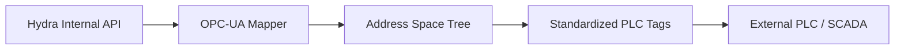

<!-- =============================================================================
HYDRA-UMC-OPCUA-SERVER - OPC-UA address space of the robot roster
Copyright (C) JuanenRac (Electro Hobby 3D) <electrohobby3d@gmail.com>
GPL-3.0-or-later - see LICENSE
============================================================================= -->

<p align="center">
  
</p>

# 🏭 HYDRA-UMC-OPCUA-SERVER

<p align="center"><a href="README.md">🇺🇸 English</a> | <a href="README_spa.md">🇪🇸 Español</a> | <a href="README_fra.md">🇫🇷 Français</a> | <a href="README_ita.md">🇮🇹 Italiano</a> | <a href="README_deu.md">🇩🇪 Deutsch</a> | <a href="README_zho.md">🇨🇳 简体中文</a> | <a href="README_jpn.md">🇯🇵 日本語</a> | 🇵🇹 <b>Português</b></p>

### 🛠️ Mapeamento de objetos HydraState para espaços de endereços OPC-UA padronizados

<p align="center">
  
  
  
  
  
  
</p>

---

**Verificação de honestidade - o que realmente funciona hoje:** o servidor OPC-UA e o mapeamento do espaço de endereços (`src/server.ts`) são reais e testados (136 testes a passar em `tests/server.test.ts`, `tests/security.test.ts`, `tests/security-policy.test.ts`, `tests/robotSource.test.ts`, `tests/robotSource.integration.test.ts`) - e são testes reais ao nível do protocolo: o `tests/server.test.ts` liga um `OPCUAClient` real (o próprio cliente do node-opcua, a mesma biblioteca que o UAExpert/Ignition usariam) pelo protocolo binário real numa porta TCP real, e o `tests/security-policy.test.ts` prova que uma sessão `SecurityPolicy.None` sem cifra é genuinamente recusada por omissão (aceite apenas através da válvula de escape explícita `OPCUA_ALLOW_INSECURE=1`). O que está deliberadamente adiado, e não é uma lacuna encontrada por acaso: a árvore por robô (`Robot_<id>`) segue a lista que o HYDRA-UMC-SERVER reporta (consultada com um token ou uma conta, veja `.env.example`), mas o resto do espaço de endereços é construído uma só vez no arranque; só as leituras/escritas estão testadas de ponta a ponta até agora, não as subscrições OPC-UA; e o Pub/Sub (Fase 1 do roteiro) continua por implementar, já que nenhum cliente depende dele ainda. Veja o `mejoras_futuras.txt` para a lista completa do que está adiado e porquê, e o `CHANGELOG.md` para saber exatamente o que foi entregue até agora.

---

> **Estado de segurança (safety e security):** este ecossistema não é um sistema de segurança certificado. Ainda não existe um caminho de E-STOP por hardware, nem limites ou interlocks impostos pelo firmware, nem um comando de movimento verificado; as imagens de firmware são verificadas com CRC-32 e uma assinatura Ed25519, e uma compilação de versão recusa as chaves de desenvolvimento publicadas (as cabeças de ferramenta e as placas de expansão atrás do relé ainda usam os bootloaders do URTC, que aceitam um HMAC-SHA256 de chave partilhada em vez de uma assinatura); TLS e TLS mútuo são opcionais e estão desativados por defeito; nenhuma placa própria foi ainda montada ou testada. Leia a [base de segurança](https://github.com/JuanenRac/HYDRA-UMC-DOCS/blob/main/docs/SECURITY_BASELINE.md) e o [modelo de ameaças](https://github.com/JuanenRac/HYDRA-UMC-DOCS/blob/main/docs/THREAT_MODEL.md) antes de confiar em qualquer afirmação aqui para a segurança de uma pessoa.

---

## 📋 Num relance

| | |
|---|---|
| Versão | `0.2.2` |
| Maturidade | Funcional |
| Testes | 136 (`npm test`) |
| Tecnologia | Node.js / node-opcua / OPC-UA address space |
| Destino | O Raspberry Pi CM5 de uma célula HYDRA-UMC |
| Em hardware real | Ainda não: não há registo de execução em hardware real para esta versão |

**Ir para:** [Visão geral](#-visão-geral) · [Arquitetura](#-arquitetura) · [Configuração](#-configuração) · [Início rápido](#-início-rápido) · [Testes](#-testes) · [Estrutura do repositório](#-estrutura-do-repositório) · [Projetos relacionados](#-projetos-relacionados)

## 🚦 Estado do projeto

Cada linha é uma parte deste repositório e a luz diz até onde chega hoje. É escrita com o que o repositório consegue demonstrar (testes, compilações, execuções), não com o que está previsto.

🟢 Feito e verificado · 🟡 Funciona, com limites conhecidos · 🟠 Feito a meio ou ainda por verificar · 🔴 Por fazer ou a não funcionar

| Área | Estado | O que significa aqui |
|---|---|---|
| Software | 🟡 | Funciona para o seu propósito principal; a verificação de honestidade acima lista o que ainda falta |
| Testes | 🟢 | 136 testes automáticos, executados a cada alteração |
| Hardware real | 🔴 | Ainda não: não há registo de execução em hardware real para esta versão |
| Documentação | 🟢 | README em oito idiomas, verificado contra o manifesto a cada alteração |

## 🎯 Visão geral

O **HYDRA-UMC-OPCUA-SERVER** é o módulo central de modelação industrial da Gateway. Traduz o HydraState interno e dinâmico (JSON) num espaço de endereços OPC-UA estruturado e descobrível.

Permite que o software de automação industrial (como o Ignition, o Siemens TIA Portal ou o Rockwell FactoryTalk) navegue, leia e escreva nas variáveis robóticas como se fossem etiquetas PLC normais.

### Funcionalidades principais:
* 🛠️ **Modelação dinâmica de informação:** gera automaticamente a árvore OPC-UA a partir dos robôs e ferramentas ativos.
* 🔄 **Lista de robôs e dois indicadores:** a lista de robôs (objetos `Robot_<id>` com `Name` e `Online`) é só de leitura; `SwarmOnline` e `MaintenanceMode` também são só de leitura (uma escrita não teria efeito no resto do sistema e é recusada); `SwarmOnline` é `BadWaitingForInitialData` até o poller da lista ter lido uma vez. Nenhum nó controla uma junta nem um efetuador.
* 🧭 **Modelo com tipos, papéis e um sinal em direto:** a célula é um `HydraCellType` e cada robô um `HydraRobotType` numa pasta `Objects/Robots` (os NodeId, no espaço de nomes 1, não mudam; o modelo é o ficheiro `nodeset/HydraUmc.NodeSet2.xml`, que um teste mantém igual ao código). `Online` é apenas o interruptor da interface do operador; `Live` diz se o robô enviou um patch ao HYDRA-UMC-SERVER dentro de `HYDRA_UMC_OPCUA_LIVE_WINDOW_MS` e `LastUpdate` quando, o que exige `HYDRA_UMC_OPCUA_SOURCE=stream` (um WebSocket em vez de sondagem) e, de outro modo, vale `BadWaitingForInitialData`. As sessões têm papéis OPC UA: anónimo é `Anonymous`, o visualizador um `Observer`, o administrador também `ConfigureAdmin`; nenhum papel pode escrever. *(experimentado com o cliente do node-opcua, nunca com um SCADA)*
* 🔖 **Espaço de nomes versionado e NodeIds estáveis:** um URI de espaço de nomes real e explícito e NodeIds de texto explícitos - uma atualização do espaço de endereços não pode alterar em silêncio o caminho de que um cliente depende. *(implementado)*
* 🔐 **Autorização de escrita por sessão:** uma verificação real e dinâmica que distingue uma sessão anónima de uma autenticada - nem todos os clientes recebem acesso de escrita por omissão. *(implementado)*
* 📡 **Suporte a subscrições:** atualizações de dados de alta eficiência através de mecanismos de publicação-subscrição do OPC-UA. *(testado de ponta a ponta: uma subscrição real entrega uma notificação de alteração de dados)*
* 🩺 **Operação (tudo opcional):** `OPCUA_HEALTH_PORT` abre um serviço de escuta à parte (só loopback, salvo indicação em contrário de `OPCUA_HEALTH_HOST`) com `GET /health` e `GET /metrics` (sessões, subscrições, inícios de sessão falhados, robôs, se a lista é legível); enquanto a lista não é legível, as variáveis `Online` dos robôs valem `false` com qualidade Uncertain em vez de um simples `false`; `OPCUA_VIEWER_USERNAME`/`OPCUA_VIEWER_PASSWORD` acrescentam uma conta só de leitura e `OPCUA_ALLOW_ANONYMOUS=0` recusa sessões anónimas; as definições da lista aceitam também os nomes `HYDRA_UMC_SERVER_*` comuns a todo o ecossistema. Tudo desligado ou sem alterações por defeito. *(implementado)*
* 🛡️ **Cifra:** toda a sessão real exige Signed ou Signed+Encrypted (Basic256Sha256, Aes128_Sha256_RsaOaep ou Aes256_Sha256_RsaPss) - uma ligação `SecurityPolicy.None` sem cifra é genuinamente recusada, e não apenas desaconselhada.

## 🧩 Papel no HYDRA-UMC

O **HYDRA-UMC-OPCUA-SERVER** publica a lista de robôs do `HYDRA-UMC-SERVER` como um espaço de endereços OPC-UA que o software SCADA e de automação pode explorar. As sessões trazem funções OPC UA e nenhuma função pode escrever: nenhum nó controla uma articulação nem um efetor.

## 🏛️ Arquitetura

<p align="center">
  
</p>

<details>
<summary>Versão em texto do diagrama (Mermaid)</summary>



</details>

### ARQUITETURA E DECISÕES DE DESENHO

* **Porque é um irmão, e não um submódulo, do HYDRA-UMC-GATEWAY-INDUSTRIAL.** Cada adaptador de protocolo é um processo implementável/reiniciável em separado - um problema na biblioteca cliente OPC-UA nunca derruba os adaptadores MQTT ou MTConnect que correm a seu lado.
* **Porque um espaço de endereços OPC-UA e não uma simples passagem REST plana.** Os clientes OPC-UA (SCADA/historiadores) esperam um espaço de endereços real e navegável, com nós tipados - uma passagem REST plana exporia tecnicamente os dados, mas anularia o sentido de falar OPC-UA.
* **Porque o ponto de entrada só imprime a identidade/versão e termina depois de um ouvinte de verificação de saúde arrancar.** Fase de andaimes (scaffolding), o mesmo raciocínio do README do projeto-mãe - uma gateway real é, por natureza, de execução prolongada, pelo que provar que o processo se mantém ativo é o verdadeiro primeiro marco.
* **Como isto se encaixa no resto do ecossistema.** Um serviço irmão sob o HYDRA-UMC-GATEWAY-INDUSTRIAL - traduz o estado do próprio HYDRA-UMC-SERVER num espaço de endereços OPC-UA real.
* **Testes reais ao nível do protocolo, não apenas uma verificação de compilação.** O `tests/server.test.ts` liga um `OPCUAClient` real (o próprio cliente do node-opcua, a mesma biblioteca que o UAExpert/Ignition usariam) a um `OPCUAServer` real pelo protocolo binário real numa porta TCP real - abre uma sessão, navega/lê `SwarmOnline`/`ActiveRobotCount` por caminho e confirma que uma escrita emitida pelo cliente se reflete tanto no valor lido de volta como no estado do lado do servidor.
* **Porque NodeIds de texto explícitos e não os numéricos atribuídos automaticamente pelo node-opcua.** Um NodeId numérico é atribuído pela ordem de criação - inserir um novo DataItem antes de um existente no código renumeraria este em silêncio, quebrando qualquer cliente industrial que tivesse fixado o número antigo. Um NodeId explícito ao estilo `s=HydraNode_1.SwarmOnline` nunca se pode deslocar debaixo de um cliente só porque o código do espaço de endereços mudou de forma.
* **Porque o `SpindleTemp` usa `timestamped_get` e não o `get()` mais simples que as outras variáveis usam.** O `get()` carimba automaticamente cada leitura com a hora atual - aceitável para um valor em direto, desonesto para um que muda devagar (um fuso não volta a aquecer entre consultas). O `timestamped_get` devolve um `DataValue` real com um `sourceTimestamp` explícito que acompanha quando o valor mudou de facto pela última vez, a semântica real em que um historiador OPC-UA se apoia.
* **O que acontece quando a fonte real do `SpindleTemp` se desliga.** O último valor real continua a ser servido - nunca retido, nunca reposto - mas o seu `statusCode` degrada de `Good` para o `UncertainLastUsableValue` real e padrão do próprio node-opcua ("o que atualizava este valor deixou de o fazer"), e o `sourceTimestamp` continua a apontar para o último instante realmente observado e não para "agora". Uma sessão corretamente autenticada e cifrada nunca anula isto - autentica o cliente, não a atualidade dos dados.
* **Porque a autorização de escrita é por sessão (`isUserWritable`) e não uma bandeira estática de nível de acesso.** Um `userAccessLevel` estático não distingue a sessão de um cliente da de outro - é igual para todas as ligações. Sobrepor o `isUserWritable(context)` no nó da variável é o mecanismo documentado do próprio node-opcua para uma verificação que varia realmente por sessão, suficientemente real para ser testado com duas identidades de cliente reais diferentes.

Deliberadamente adiado, e porquê: um espaço de endereços totalmente dinâmico (a árvore por robô já segue a lista que o HYDRA-UMC-SERVER reporta; o resto é construído uma só vez no arranque); e o item de Pub/Sub do roteiro (ainda por implementar - nenhum cliente depende dele ainda).

## ⚙️ Configuração

A porta de escuta é lida primeiro de `HYDRA_UMC_OPCUA_PORT` (4840 por predefinição). O `PORT` partilhado continua a valer como último recurso e mostra um aviso, para que um ficheiro de ambiente partilhado por vários serviços não possa mudar o servidor para a porta de outro serviço por acidente; um valor definido mas que não é uma porta válida interrompe o arranque, e a verificação de saúde do contentor segue a mesma ordem. O acesso histórico vem desativado por omissão. `HYDRA_UMC_OPCUA_HISTORY=1` ativa-o, `HYDRA_UMC_OPCUA_HISTORY_URL` indica o HYDRA-UMC-DATALAKE (com `HYDRA_UMC_OPCUA_HISTORY_TOKEN` se tiver um token de leitura) e `HYDRA_UMC_OPCUA_HISTORY_MAP` é um ficheiro JSON que associa variáveis a séries; só as variáveis associadas respondem a um HistoryRead, as sessões anónimas são recusadas exceto com `HYDRA_UMC_OPCUA_HISTORY_ANONYMOUS=1`, e uma leitura toma no máximo `HYDRA_UMC_OPCUA_HISTORY_MAX_POINTS` pontos (10000 por omissão). Nada passa a ser gravável. O histórico processado também vem desativado por omissão: `HYDRA_UMC_OPCUA_HISTORY_AGGREGATES=1` faz com que responda Average, Minimum, Maximum, Count e Interpolative (no máximo `HYDRA_UMC_OPCUA_HISTORY_MAX_INTERVALS` intervalos por leitura, 1000 por omissão), e `HYDRA_UMC_OPCUA_HISTORY_EVENTS=1` com `HYDRA_UMC_OPCUA_HISTORY_EVENTS_MAP` (um ficheiro JSON com regras de limites por objeto) faz com que responda o histórico de eventos derivado das séries guardadas.

## 🚀 Início rápido

Requer Node.js 20 ou superior com npm.

```bash
npm install
npm test
npm run build
npm start
```

## 🧪 Testes

136 testes automáticos correm com `npm test`. Não precisam de hardware nem de nada fora desta máquina.

A CI executa `HYDRA_UMC_CI=1 python tools/ci_validate.py`, que verifica o manifesto, os documentos, os oito README e as imagens.

## 🏗️ Compilação e publicação

### Requisitos
- [Node.js](https://nodejs.org/) (v20 ou superior recomendado)
- npm

### Instalação
```bash
npm install
```

### Modo de desenvolvimento
Executa o servidor OPC-UA diretamente com o `tsx` (sem empacotador):
- **Windows:** faça duplo clique em `dev.bat` ou execute `npm run dev`
- **Linux/Mac:** execute `./dev.sh` ou `npm run dev`

### Compilação de produção
Empacota o servidor num único ficheiro implementável com o esbuild:
- **Windows:** faça duplo clique em `build.bat` ou execute `npm run build`
- **Linux/Mac:** execute `./build.sh` ou `npm run build`

Depois arranque-o com:
```bash
npm start
```

O servidor escuta em `0.0.0.0:4840` (a porta OPC-UA por omissão registada na IANA)
no endpoint `opc.tcp://<host>:4840/HYDRA-UMC-OPCUA-SERVER` - aponte qualquer cliente
OPC-UA (UAExpert, Ignition, Siemens TIA Portal, ...) para ele para
navegar no espaço de endereços.

### Versionamento
`npm run build` apenas empacota o servidor. A versão só é subida por `python tools/hydra_project_tool.py bump` (através de `bump_manifest_version.py`), um "conta-quilómetros" em base 10: patch +1 por bump, com transporte para minor (e de minor para major) depois de 9, em vez de alguma vez chegar a um segmento de dois dígitos (`0.0.9` -> `0.1.0`, não `0.0.10`).

## 📂 Estrutura do repositório

<p align="center">
  
</p>

<details>
<summary>Versão em texto da árvore</summary>

```text
HYDRA-UMC-OPCUA-SERVER/
├── src/                       Código-fonte (Node/TypeScript - Modelo, Servidor, Mapeador)
├── tests/                     Suite Vitest - comportamento do servidor e da segurança
├── docs/                      OPERATIONS.md: o que um integrador precisa para executar, ligar-se a e expor com segurança este servidor
├── nodeset/                   HydraUmc.NodeSet2.xml: o modelo de informação do espaço de nomes como ficheiro NodeSet2 (scripts/export_nodeset.ts escreve-o e verifica-o)
├── images/                    Multimédia e diagramas
├── scripts/                   Scripts utilitários (bump-version.mjs, export_nodeset.ts)
├── tools/                     build_test.py (verificação de compilação sem versionar), ci_validate.py (validação de manifesto/CHANGELOG/docs usada pela CI), hydra_project_tool.py e os partilhados _doc_policy.py e _readme_parity.py
├── .github/                   fluxo de CI e modelos de problemas
├── mejoras_futuras.txt        A lista completa e honesta do que está deliberadamente adiado e porquê
├── CHANGELOG.md               o que mudou em cada versão
├── Dockerfile                 imagem de contentor
├── build-test.sh              verificação de compilação sem alterações
├── build.sh                   compila e verifica; nunca muda a versão
├── bump_manifest_version.py   sincroniza a versão do manifesto
├── dev.sh                     modo de desenvolvimento
├── hydra-umc.project.json     manifesto: versão, maturidade, família
├── package.json               metadados e scripts do pacote
└── test.sh                    executa os testes
```

</details>

## 🗺️ Roteiro e limites conhecidos

**Limites conhecidos hoje**

* **Fase 1:** implementação de OPC-UA Pub/Sub para troca de dados a alta velocidade e ponte com protocolos herdados.
* **Fase 2:** o broker MQTT já existe como repositório próprio ([HYDRA-UMC-MQTT-BROKER](https://github.com/JuanenRac/HYDRA-UMC-MQTT-BROKER)); o cluster para a gestão massiva de dispositivos IoT e a elevada concorrência continua planeado.
* **Fase 3:** o adaptador MTConnect já existe como repositório próprio ([HYDRA-UMC-MTCONNECT-ADAPTER](https://github.com/JuanenRac/HYDRA-UMC-MTCONNECT-ADAPTER)); a integração de maquinaria CNC e PLC de vários fabricantes para além dele continua planeada.
* **Fase 4:** conformidade total com a especificação de companheiro OPC UA Robotics e sincronização da gateway industrial.

## 🌍 Idiomas

Este README e os documentos do repositório existem em oito idiomas: inglês, espanhol, alemão, francês, italiano, japonês, chinês e português (Portugal). São escritos em conjunto e a CI verifica que os oito ficheiros têm as mesmas secções e as mesmas ligações. Este repositório não tem ecrã nem catálogo de mensagens próprios, por isso não há textos de interface para traduzir.

## 🔗 Projetos relacionados

Este projeto faz parte do ecossistema de robótica HYDRA-UMC do mesmo autor (JuanenRac / Electro Hobby 3D). Vale a pena conhecê-los, porque um pedido pode ser, na verdade, sobre um destes e não sobre este repositório.

**Projeto-mãe**
- **[HYDRA-UMC-GATEWAY-INDUSTRIAL](https://github.com/JuanenRac/HYDRA-UMC-GATEWAY-INDUSTRIAL)** — centro de integração que retransmite para protocolos industriais, com uma camada real de lista de comandos permitidos e contrapressão; o projeto-mãe de que este repositório é um adaptador de protocolo específico, dentro da sua própria gateway industrial.

**Projetos irmãos** — os outros adaptadores de protocolo da própria gateway industrial do HYDRA-UMC-GATEWAY-INDUSTRIAL
- **[HYDRA-UMC-MQTT-BROKER](https://github.com/JuanenRac/HYDRA-UMC-MQTT-BROKER)** — broker MQTT real com autenticação opcional por cliente e ACL de tópicos.
- **[HYDRA-UMC-MTCONNECT-ADAPTER](https://github.com/JuanenRac/HYDRA-UMC-MTCONNECT-ADAPTER)** — endpoints XML MTConnect `/probe` e `/current` reais com saída em modo degradado.

**Diretamente relacionados**
- **[HYDRA-UMC-SERVER](https://github.com/JuanenRac/HYDRA-UMC-SERVER)** — o back-end headless real (REST/WebSocket) com que todos os clientes de controlo realmente comunicam — a origem do estado que este adaptador expõe.

**Também fazem parte do ecossistema**

*Hardware e plataforma centrais*
- **[HYDRA-UMC](https://github.com/JuanenRac/HYDRA-UMC)** — o desenho da placa-mãe do braço robótico: anfitrião CM5 + STM32H745 de dois núcleos, pensado para orquestrar até 8 braços de ferramenta por CAN-OTA/SPI-OTA (firmware numa fase inicial; ainda sem placa montada).
- **[HYDRA-UMC-OS](https://github.com/JuanenRac/HYDRA-UMC-OS)** — camada de produto reproduzível do Raspberry Pi OS para o CM5: agente só de leitura, configuração/perfis validados, aprovisionamento Wi-Fi de primeiro contacto.
- **[HYDRA-UMC-SDK](https://github.com/JuanenRac/HYDRA-UMC-SDK)** — o contrato JSON-Schema partilhado e a fronteira de software de controlo de trabalhos contra a qual cada bridge valida os seus comandos (não é uma função de segurança certificada).
- **[HYDRA-UMC-CONNECTOR-HUB](https://github.com/JuanenRac/HYDRA-UMC-CONNECTOR-HUB)** — registo declarativo de manifestos de adaptador e validador para conectores de máquinas externas; estende a ideia de contrato do SDK a máquinas externas sem substituir os projetos de gateway industrial.

*Backend central e clientes*
- **[HYDRA-UMC-STUDIO](https://github.com/JuanenRac/HYDRA-UMC-STUDIO)** — painel web de controlo com visualização 3D em tempo real de vários robôs.
- **[HYDRA-UMC-SUITE](https://github.com/JuanenRac/HYDRA-UMC-SUITE)** — centro de comando de enxame para desktop (PySide6) para vários servidores ao mesmo tempo, empacotado como executável independente.
- **[HYDRA-UMC-ANDROID-CONTROL](https://github.com/JuanenRac/HYDRA-UMC-ANDROID-CONTROL)** — aplicação Android nativa de controlo, com início de sessão biométrico e um companheiro Wear OS emparelhado.
- **[HYDRA-UMC-IOS-CONTROL](https://github.com/JuanenRac/HYDRA-UMC-IOS-CONTROL)** — aplicação de controlo para iOS/iPadOS (Flutter) com sincronização WebSocket em tempo real.
- **[HYDRA-UMC-DSI](https://github.com/JuanenRac/HYDRA-UMC-DSI)** — interface tátil nativa para o ecrã tátil DSI de 7" integrado, executada no próprio CM5.
- **[HYDRA-UMC-EDITOR-URDF](https://github.com/JuanenRac/HYDRA-UMC-EDITOR-URDF)** — criador/editor gráfico de URDF para desktop que envia os modelos concluídos para o catálogo do STUDIO.
- **[HYDRA-UMC-EDITOR-STL](https://github.com/JuanenRac/HYDRA-UMC-EDITOR-STL)** — editor de modelos STL para desktop que transforma/substitui/remove/adiciona peças reais no mesmo catálogo de modelos que o HYDRA-UMC-EDITOR-URDF também edita.
- **[HYDRA-UMC-BRIDGE-AMR](https://github.com/JuanenRac/HYDRA-UMC-BRIDGE-AMR)** — fronteira de coordenação para frotas AGV/AMR através de um publicador MQTT VDA 5050 (testado apenas contra uma frota emulada).
- **[HYDRA-UMC-BRIDGE-CNC](https://github.com/JuanenRac/HYDRA-UMC-BRIDGE-CNC)** — coordenador de células CNC de alto nível com acesso ao estado GRBL e aos bytes de controlo (testado apenas contra um emulador).
- **[HYDRA-UMC-BRIDGE-DROIDS](https://github.com/JuanenRac/HYDRA-UMC-BRIDGE-DROIDS)** — fronteira de coordenação para droides com patas/humanoides, com um emissor de comandos para o Boston Dynamics Spot (testado apenas contra um emulador).
- **[HYDRA-UMC-BRIDGE-LASER](https://github.com/JuanenRac/HYDRA-UMC-BRIDGE-LASER)** — coordenador de células laser que lê 3 sinais GPIO (chave, caixa e interlock) (testado apenas contra um chip simulado; não pode armar nem disparar um laser).
- **[HYDRA-UMC-BRIDGE-OPENPNP](https://github.com/JuanenRac/HYDRA-UMC-BRIDGE-OPENPNP)** — coordenador seguro de fluxo de placa de alto nível para pick-and-place com OpenPnP.
- **[HYDRA-UMC-BRIDGE-PRINTER3D](https://github.com/JuanenRac/HYDRA-UMC-BRIDGE-PRINTER3D)** — fronteira de coordenação segura para impressoras 3D Moonraker/Klipper, com comandos de trabalho reais protegidos por portas.
- **[HYDRA-UMC-BRIDGE-ROS2](https://github.com/JuanenRac/HYDRA-UMC-BRIDGE-ROS2)** — coordenador com um transporte ROS 2 baseado em rclpy importado sob demanda (ainda não executado contra uma instalação ROS 2).
- **[HYDRA-UMC-BRIDGE-UAV](https://github.com/JuanenRac/HYDRA-UMC-BRIDGE-UAV)** — fronteira de coordenação para UAV com câmara, com um emissor de comandos MAVLink (testado apenas contra um emulador).

*Plataforma de ferramentas URTC*
- **[URTC](https://github.com/JuanenRac/URTC)** — firmware da placa física Universal Robot Tool Controller, mais de 25 perfis de ferramenta por barramento CAN.
- **[URTC-FLASHER](https://github.com/JuanenRac/URTC-FLASHER)** — ferramenta gráfica de gravação para desktop das placas URTC, por CAN-OTA e também SWD/JTAG de chip completo.
- **[URTC-TESTER](https://github.com/JuanenRac/URTC-TESTER)** — ferramenta de diagnóstico CAN em tempo real para desktop das placas URTC, com um painel por perfil de ferramenta.
- **[URTC-WEB-STUDIO](https://github.com/JuanenRac/URTC-WEB-STUDIO)** — alternativa no navegador ao URTC-TESTER através da Web Serial API, sem instalação local.
- **[URTC-GATEWAY](https://github.com/JuanenRac/URTC-GATEWAY)** — gateway à frente do barramento CAN do URTC: lista de identificadores permitidos, limite de taxa e chave de sessão; software testado num computador, ainda não num barramento real.

*Nó de IA de visão (Hailo-8)*
- **[HYDRA-UMC-VISION-NODE](https://github.com/JuanenRac/HYDRA-UMC-VISION-NODE)** — centro de integração do pipeline de visão Hailo-8, com uma verificação real de prontidão de hardware por fase.
- **[HYDRA-UMC-DETECTION-HEF](https://github.com/JuanenRac/HYDRA-UMC-DETECTION-HEF)** — registo real de modelos compilados com verificação segura de carga por arquitetura Hailo e soma de verificação.
- **[HYDRA-UMC-VISION-STREAMER](https://github.com/JuanenRac/HYDRA-UMC-VISION-STREAMER)** — pipeline GStreamer real e gerador de configuração MediaMTX com uma fronteira de integração HailoRT real.
- **[HYDRA-UMC-VISUAL-SERVOING-API](https://github.com/JuanenRac/HYDRA-UMC-VISUAL-SERVOING-API)** — lei de correção de servovisão baseada em posição com autorização condicionada ao estado da zona; ainda sem estimativa de pose por câmara.
- **[HYDRA-UMC-SAFETY-ZONES](https://github.com/JuanenRac/HYDRA-UMC-SAFETY-ZONES)** — lógica v0 de violação de zonas, atualidade da calibração e pedido de E-STOP que lê as posições dos objetos de um ficheiro; nenhum detetor a alimenta e ainda não há E-STOP físico ligado.

*Nó de IA cognitiva (Hailo-10)*
- **[HYDRA-UMC-COGNITIVE-NODE](https://github.com/JuanenRac/HYDRA-UMC-COGNITIVE-NODE)** — centro de integração do pipeline cognitivo do Hailo-10 (orquestração de LLM/VLA/voz).
- **[HYDRA-UMC-VLA-ENGINE](https://github.com/JuanenRac/HYDRA-UMC-VLA-ENGINE)** — codificação/descodificação real de tokens de ação e geração de trajetórias para um modelo Visão-Linguagem-Ação.
- **[HYDRA-UMC-VOICE-UI](https://github.com/JuanenRac/HYDRA-UMC-VOICE-UI)** — front-end de voz real (VAD + analisador de intenções) com um relé para o relógio limitado e protegido por confirmação.
- **[HYDRA-UMC-SEMANTIC-PLANNER](https://github.com/JuanenRac/HYDRA-UMC-SEMANTIC-PLANNER)** — decomposição real de tarefas baseada em regras e recuperação semântica de erros sobre os códigos de erro do MCU.
- **[HYDRA-UMC-DOCS-QA](https://github.com/JuanenRac/HYDRA-UMC-DOCS-QA)** — pesquisa real de documentos TF-IDF só com a biblioteca padrão sobre a documentação Markdown deste ecossistema.
- **[HYDRA-UMC-LOCAL-TECHNICIAN](https://github.com/JuanenRac/HYDRA-UMC-LOCAL-TECHNICIAN)** — técnico de manutenção de IA local, protegido por políticas, para o próprio ecossistema: observa, diagnostica e propõe correções; os dois níveis de maior risco não estão implementados de propósito.

*Orquestração e enxame*
- **[HYDRA-UMC-ORCHESTRATOR](https://github.com/JuanenRac/HYDRA-UMC-ORCHESTRATOR)** — centro de integração com um contrato real de relatório de saúde gRPC/Protobuf e uma máquina de estados de missões.
- **[HYDRA-UMC-JOB-DISPATCHER](https://github.com/JuanenRac/HYDRA-UMC-JOB-DISPATCHER)** — fila real de trabalhos por prioridade com deduplicação, sobre uma API HTTP real.
- **[HYDRA-UMC-NODE-HEALING](https://github.com/JuanenRac/HYDRA-UMC-NODE-HEALING)** — vigilante real de saúde da frota por gRPC com repetição/recuo e deteção de identidade incoerente.
- **[HYDRA-UMC-PATH-PLANNER-3D](https://github.com/JuanenRac/HYDRA-UMC-PATH-PLANNER-3D)** — planeador real de trajetórias 3D baseado em RRT com validação real de colisões com obstáculos e espaço de trabalho.
- **[HYDRA-UMC-SWARM-SYNC](https://github.com/JuanenRac/HYDRA-UMC-SWARM-SYNC)** — sincronização real de estado CRDT LWW-Element-Map, testada por propriedades para a convergência de várias células.

*Gémeo digital e simulação*
- **[HYDRA-UMC-TWIN](https://github.com/JuanenRac/HYDRA-UMC-TWIN)** — centro de integração do motor de gémeo digital, com um contrato real de sincronização de compatibilidade de versões.
- **[HYDRA-UMC-HIL-BRIDGE](https://github.com/JuanenRac/HYDRA-UMC-HIL-BRIDGE)** — encaminhador hardware-in-the-loop com um interlock de software de colisão entre a simulação e o hardware real (testado sem hardware real).
- **[HYDRA-UMC-PHYSICS-REPLICA](https://github.com/JuanenRac/HYDRA-UMC-PHYSICS-REPLICA)** — cinemática direta real e validação de limites de juntas sobre um subconjunto real de URDF.
- **[HYDRA-UMC-SYNTHETIC-DATA-GEN](https://github.com/JuanenRac/HYDRA-UMC-SYNTHETIC-DATA-GEN)** — gerador procedural real de cenas 2D com exportação de anotações YOLO/COCO.

*Dados e análise*
- **[HYDRA-UMC-DATALAKE](https://github.com/JuanenRac/HYDRA-UMC-DATALAKE)** — armazém real de séries temporais sobre sqlite3 com uma API HTTP real de ingestão/consulta.
- **[HYDRA-UMC-ANOMALY-DETECTOR](https://github.com/JuanenRac/HYDRA-UMC-ANOMALY-DETECTOR)** — detetor real de anomalias por FFT e linha de base estatística, com monitorização de deriva.
- **[HYDRA-UMC-PRODUCTION-REPORTS](https://github.com/JuanenRac/HYDRA-UMC-PRODUCTION-REPORTS)** — cálculo real de OEE/disponibilidade sobre o histórico do DATALAKE, com exportação CSV reprodutível.
- **[HYDRA-UMC-TELEMETRY-COLLECTOR](https://github.com/JuanenRac/HYDRA-UMC-TELEMETRY-COLLECTOR)** — pipeline real de ingestão CAN/WebSocket para o DATALAKE, com deduplicação por sequência.

*Ferramentas complementares e operações do ecossistema*
- **[HYDRA-UMC-DASHBOARD-AI](https://github.com/JuanenRac/HYDRA-UMC-DASHBOARD-AI)** — painéis de Resumos Inteligentes e Realce de Anomalias sobre o DATALAKE/ANOMALY-DETECTOR, com um recurso estatístico honesto.
- **[HYDRA-UMC-TOOL-CLI](https://github.com/JuanenRac/HYDRA-UMC-TOOL-CLI)** — CLI da frota com um contrato de códigos de saída real e estável, um cliente vivo genuíno da API do HYDRA-UMC-SERVER.
- **[HYDRA-UMC-WATCH](https://github.com/JuanenRac/HYDRA-UMC-WATCH)** — aplicação companheira WearOS com padrões de alerta tátil e um relé de voz para o telemóvel emparelhado (ainda não executada num relógio físico).
- **[URTC-SMART-RACK](https://github.com/JuanenRac/URTC-SMART-RACK)** — firmware de um rack de montagem de placas com descodificação real do ID da ferramenta e lógica de pré-aquecimento Smart Idle.
- **[URTC-VISION-TOOL](https://github.com/JuanenRac/URTC-VISION-TOOL)** — firmware mais um companheiro de visão em Python real para uma cabeça de ferramenta de inspeção térmica/RGB.
- **[HYDRA-UMC-UPDATER](https://github.com/JuanenRac/HYDRA-UMC-UPDATER)** — ferramenta administrativa de desktop que descobre, clona e atualiza todos os repositórios deste ecossistema.
- **[HYDRA-UMC-OS-REBUILDER](https://github.com/JuanenRac/HYDRA-UMC-OS-REBUILDER)** — ferramenta de desktop para Windows/Linux que constrói uma imagem do CM5 pronta a gravar com as versões mais recentes do ecossistema, com configuração de primeiro arranque de Wi-Fi/utilizador/SSH ao estilo do Raspberry Pi Imager.
- **[HYDRA-UMC-OPS-AGENT](https://github.com/JuanenRac/HYDRA-UMC-OPS-AGENT)** — coordenador de incidentes de manutenção: um papel de borda de poucos privilégios recolhe um inventário/estado higienizado, um papel de plano de controlo mostra-o só de leitura e pede a um fornecedor de IA que sugira um diagnóstico; nunca aplica um patch nem implanta nada.
- **[HYDRA-UMC-DEV-SERVER](https://github.com/JuanenRac/HYDRA-UMC-DEV-SERVER)** — anfitrião de desenvolvimento reproduzível (Raspberry Pi 5 / CM5) que guarda o código-fonte do ecossistema e executa tarefas limitadas de compilação/teste numa fila durável; um papel de desenvolvimento dedicado, explicitamente não um CM5 operacional.

## 📚 Documentação

Onde ler mais:

* [Base de segurança do ecossistema](https://github.com/JuanenRac/HYDRA-UMC-DOCS/blob/main/docs/SECURITY_BASELINE.md)
* [Modelo de ameaças do ecossistema](https://github.com/JuanenRac/HYDRA-UMC-DOCS/blob/main/docs/THREAT_MODEL.md)
* [Registo de alterações deste repositório](CHANGELOG.md)
* [Licença deste repositório](LICENSE.md)

## 🤝 Contribuir e comunidade

* Antes de um pull request execute `HYDRA_UMC_CI=1 py -3 tools/ci_validate.py` (ou `HYDRA_UMC_CI=1 python3 tools/ci_validate.py`): tem de imprimir `CI_VALIDATION=PASS`. Não execute `build.sh` nem `build.bat` para esta verificação; compilar não é verificar.
* Os oito README são escritos a partir de uma única fonte em HYDRA-UMC-DOCS; não os edite à mão. Altere a fonte e escreva-os de novo com `tools/make_readmes.py`.
* Não afirme num README o que não foi executado: diga «simulado» ou «não testado em hardware» quando for a verdade.
* Consulte [CONTRIBUTING.md](CONTRIBUTING.md), o [código de conduta](CODE_OF_CONDUCT.md), [SECURITY.md](SECURITY.md) e [SUPPORT.md](SUPPORT.md).

## 👤 AUTOR

**JuanenRac (Electro Hobby 3D)** · electrohobby3d@gmail.com

## 📜 LICENÇA

GPL-3.0-or-later - [LICENSE](LICENSE).
