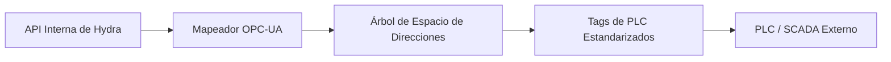

<!-- =============================================================================
HYDRA-UMC-OPCUA-SERVER - OPC-UA address space of the robot roster
Copyright (C) JuanenRac (Electro Hobby 3D) <electrohobby3d@gmail.com>
GPL-3.0-or-later - see LICENSE
============================================================================= -->

<p align="center">
  
</p>

# 🏭 HYDRA-UMC-OPCUA-SERVER

<p align="center"><a href="README.md">🇺🇸 English</a> | 🇪🇸 <b>Español</b> | <a href="README_fra.md">🇫🇷 Français</a> | <a href="README_ita.md">🇮🇹 Italiano</a> | <a href="README_deu.md">🇩🇪 Deutsch</a> | <a href="README_zho.md">🇨🇳 简体中文</a> | <a href="README_jpn.md">🇯🇵 日本語</a> | <a href="README_por.md">🇵🇹 Português</a></p>

### 🛠️ Mapeo de Objetos HydraState a Espacios de Direcciones OPC-UA Estandarizados

<p align="center">
  
  
  
  
  
  
</p>

---

**Comprobación de honestidad - qué funciona realmente hoy:** el servidor OPC-UA y el mapeo del espacio de direcciones (`src/server.ts`) son reales y están testeados (136 tests pasando entre `tests/server.test.ts`, `tests/security.test.ts`, `tests/security-policy.test.ts`, `tests/robotSource.test.ts`, `tests/robotSource.integration.test.ts`) - y son tests reales a nivel de protocolo: `tests/server.test.ts` conecta un `OPCUAClient` real (el propio cliente de node-opcua, la misma librería que usarían UAExpert/Ignition) sobre el protocolo binario real en un puerto TCP real, y `tests/security-policy.test.ts` demuestra que una sesión sin cifrar `SecurityPolicy.None` es genuinamente rechazada por defecto (aceptada solo vía la vía de escape explícita `OPCUA_ALLOW_INSECURE=1`). Lo que está deliberadamente diferido, no es una brecha encontrada por accidente: el árbol por robot (`Robot_<id>`) sigue la lista que informa HYDRA-UMC-SERVER (consultada con un token o una cuenta, ver `.env.example`), pero el resto del espacio de direcciones se construye una sola vez al arrancar; solo las lecturas/escrituras están testeadas de extremo a extremo por ahora, no las suscripciones OPC-UA; y Pub/Sub (Fase 1 del Roadmap) sigue sin implementar, ya que ningún cliente depende todavía de ello. Ver `mejoras_futuras.txt` para la lista completa de lo diferido y por qué, y `CHANGELOG.md` para lo que se ha entregado exactamente hasta ahora.

---

> **Estado de seguridad física y de ciberseguridad:** este ecosistema no es un sistema de seguridad certificado. Todavía no existe una ruta de E-STOP por hardware, ni límites ni enclavamientos aplicados por el firmware, ni un comando de movimiento verificado; las imágenes de firmware se comprueban con CRC-32 y una firma Ed25519, y una compilación de versión rechaza las claves de desarrollo publicadas (los cabezales de herramienta y las placas de expansión detrás del relé siguen con cargadores de URTC, que usan un HMAC-SHA256 de clave compartida en lugar de una firma); TLS y TLS mutuo son opcionales y están desactivados por defecto; aún no se ha poblado ni probado ninguna placa propia. Lee la [línea base de seguridad](https://github.com/JuanenRac/HYDRA-UMC-DOCS/blob/main/docs/SECURITY_BASELINE.md) y el [modelo de amenazas](https://github.com/JuanenRac/HYDRA-UMC-DOCS/blob/main/docs/THREAT_MODEL.md) antes de fiarte de cualquier afirmación de aquí para la seguridad de una persona.

---

## 📋 De un vistazo

| | |
|---|---|
| Versión | `0.2.1` |
| Madurez | Funcional |
| Tests | 136 (`npm test`) |
| Tecnología | Node.js / node-opcua / OPC-UA address space |
| Destino | La Raspberry Pi CM5 de una celda HYDRA-UMC |
| En hardware real | Todavía no: no consta ninguna ejecución en hardware real para esta versión |

**Ir a:** [Resumen](#-resumen) · [Arquitectura](#-arquitectura) · [Configuración](#-configuración) · [Inicio rápido](#-inicio-rápido) · [Pruebas](#-pruebas) · [Estructura del repositorio](#-estructura-del-repositorio) · [Proyectos relacionados](#-proyectos-relacionados)

## 🚦 Estado del proyecto

Cada línea es una parte de este repositorio y la luz dice hasta dónde llega hoy. Se escribe con lo que el repositorio puede demostrar (pruebas, compilaciones, ejecuciones), no con lo previsto.

🟢 Hecho y verificado · 🟡 Funciona, con límites conocidos · 🟠 Hecho a medias o sin verificar · 🔴 Sin hacer o sin funcionar

| Área | Estado | Qué significa aquí |
|---|---|---|
| Software | 🟡 | Funciona para su propósito principal; la comprobación de honestidad de arriba lista lo que aún falta |
| Pruebas | 🟢 | 136 pruebas automáticas, ejecutadas en cada cambio |
| Hardware real | 🔴 | Todavía no: no consta ninguna ejecución en hardware real para esta versión |
| Documentación | 🟢 | README en ocho idiomas, comprobado contra el manifiesto en cada cambio |

## 🎯 Resumen

**HYDRA-UMC-OPCUA-SERVER** es el módulo de modelado industrial central para el Gateway. Traduce el HydraState interno y dinámico (JSON) en un espacio de direcciones OPC-UA estructurado y descubrible.

Permite que el software de automatización industrial (como Ignition, Siemens TIA Portal o Rockwell FactoryTalk) explore, lea y escriba en variables robóticas como si fueran tags de PLC estándar.

### Características Clave:
* 🛠️ **Modelado de Información Dinámico:** Genera automáticamente el árbol OPC-UA basado en los robots y herramientas activos.
* 🔄 **Lista de robots y dos indicadores:** la lista de robots (objetos `Robot_<id>` con `Name` y `Online`) es de solo lectura; `SwarmOnline` y `MaintenanceMode` también son de solo lectura (una escritura no tendría efecto en el resto del sistema y se rechaza); `SwarmOnline` es `BadWaitingForInitialData` hasta que el sondeo de la lista haya leído una vez. Ningún nodo controla una articulación ni un efector.
* 🧭 **Modelo con tipos, roles y una señal en vivo:** la celda es un `HydraCellType` y cada robot un `HydraRobotType` bajo una carpeta `Objects/Robots` (los NodeId, en el espacio de nombres 1, no cambian; el modelo es el fichero `nodeset/HydraUmc.NodeSet2.xml`, que una prueba mantiene igual al código). `Online` es solo el interruptor de la interfaz del operador; `Live` dice si el robot envió un parche a HYDRA-UMC-SERVER dentro de `HYDRA_UMC_OPCUA_LIVE_WINDOW_MS` y `LastUpdate` cuándo, lo que exige `HYDRA_UMC_OPCUA_SOURCE=stream` (un WebSocket en lugar de sondeo) y, si no, vale `BadWaitingForInitialData`. Las sesiones tienen roles OPC UA: anónimo es `Anonymous`, el visor un `Observer`, el administrador además `ConfigureAdmin`; ningún rol puede escribir. *(probado con el cliente de node-opcua, nunca con un SCADA)*
* 🔖 **Espacio de Nombres Versionado y NodeIds Estables:** Una URI de espacio de nombres real y explícita, y NodeIds de tipo string explícitos - una actualización del espacio de direcciones no puede cambiar silenciosamente la ruta de la que depende un cliente. *(implementado)*
* 🔐 **Autorización de Escritura por Sesión:** Una comprobación real y dinámica que distingue una sesión anónima de una autenticada - no todos los clientes obtienen acceso de escritura por defecto. *(implementado)*
* 📡 **Soporte de Suscripción:** Actualizaciones de datos de alta eficiencia usando mecanismos de publicación-suscripción de OPC-UA. *(probado de extremo a extremo: una suscripción real entrega una notificación de cambio de datos)*
* 🩺 **Operación (todo opcional):** `OPCUA_HEALTH_PORT` abre un listener aparte (solo loopback salvo que `OPCUA_HEALTH_HOST` diga otra cosa) con `GET /health` y `GET /metrics` (sesiones, suscripciones, inicios de sesión fallidos, robots, si se puede leer la lista); mientras no se puede leer la lista, las variables `Online` de los robots valen `false` con calidad Uncertain en lugar de un `false` sin más; `OPCUA_VIEWER_USERNAME`/`OPCUA_VIEWER_PASSWORD` añaden una cuenta de solo lectura y `OPCUA_ALLOW_ANONYMOUS=0` rechaza las sesiones anónimas; los ajustes de la lista aceptan también los nombres `HYDRA_UMC_SERVER_*` comunes a todo el ecosistema. Todo desactivado o sin cambios por defecto. *(implementado)*
* 🛡️ **Cifrado:** toda sesión real exige Signed o Signed+Encrypted (Basic256Sha256, Aes128_Sha256_RsaOaep o Aes256_Sha256_RsaPss) - una conexión sin cifrar con `SecurityPolicy.None` es rechazada de verdad, no solo desaconsejada.

## 🧩 Papel en HYDRA-UMC

**HYDRA-UMC-OPCUA-SERVER** publica la lista de robots de `HYDRA-UMC-SERVER` como un espacio de direcciones OPC-UA que el software SCADA y de automatización puede explorar. Las sesiones llevan roles OPC UA y ningún rol puede escribir: ningún nodo controla una articulación ni un efector.

## 🏛️ Arquitectura

<p align="center">
  
</p>

<details>
<summary>Versión en texto del diagrama (Mermaid)</summary>



</details>

### ARQUITECTURA Y DECISIONES DE DISEÑO

* **Por qué es hermano, no un submódulo, de HYDRA-UMC-GATEWAY-INDUSTRIAL.** Cada adaptador de protocolo es un proceso desplegable/reiniciable por separado - un problema en la librería cliente de OPC-UA nunca tumba los adaptadores de MQTT o MTConnect que corren junto a él.
* **Por qué un espacio de direcciones OPC-UA, no un simple passthrough REST.** Los clientes OPC-UA (SCADA/históricos) esperan un espacio de direcciones real y navegable con nodos tipados - un passthrough REST plano expondría técnicamente los datos pero anularía el sentido de hablar OPC-UA.
* **Cómo encaja en el resto del ecosistema.** Un servicio hermano bajo HYDRA-UMC-GATEWAY-INDUSTRIAL - traduce el propio estado de HYDRA-UMC-SERVER a un espacio de direcciones OPC-UA real.
* **Tests reales a nivel de protocolo, no solo una comprobación de compilación.** `tests/server.test.ts` conecta un `OPCUAClient` real (el propio cliente de node-opcua, la misma librería que usarían UAExpert/Ignition) contra un `OPCUAServer` real por el protocolo binario real en un puerto TCP real - abriendo una sesión, navegando/leyendo `SwarmOnline`/`ActiveRobotCount` por ruta, y confirmando que una escritura emitida por el cliente se refleja tanto en el valor leído de vuelta como en el estado interno del servidor.
* **Por qué NodeIds de tipo string explícitos, no los numéricos auto-asignados de node-opcua.** Un NodeId numérico se asigna por orden de creación - insertar un nuevo DataItem antes de uno existente en el código lo renumeraría silenciosamente, rompiendo cualquier cliente industrial que tuviera el número antiguo hardcodeado. Un NodeId explícito al estilo `s=HydraNode_1.SwarmOnline` nunca puede desplazarse bajo un cliente solo porque el código del espacio de direcciones cambió de forma.
* **Por qué `SpindleTemp` usa `timestamped_get`, no el `get()` más simple que usan las demás variables.** `get()` sella automáticamente cada lectura con la hora actual - adecuado para un valor en vivo, deshonesto para uno que cambia lentamente (un husillo no se recalienta entre sondeos). `timestamped_get` devuelve un `DataValue` real con un `sourceTimestamp` explícito que registra cuándo cambió realmente el valor por última vez, la semántica real en la que se apoya un histórico de OPC-UA.
* **Qué pasa cuando la fuente real de `SpindleTemp` se desconecta.** El último valor real se sigue sirviendo - nunca se oculta ni se reinicia - pero su `statusCode` degrada de `Good` al código real y estándar de node-opcua `UncertainLastUsableValue` ("Whatever was updating this value has stopped doing so"), y `sourceTimestamp` sigue apuntando al instante real de la última observación, no a "ahora". Una sesión correctamente autenticada y cifrada nunca cambia esto - autentica al cliente, no la frescura del dato.
* **Por qué la autorización de escritura es por sesión (`isUserWritable`), no un flag estático de nivel de acceso.** Un `userAccessLevel` estático no puede distinguir la sesión de un cliente de la de otro - es el mismo para cada conexión. Sobrescribir `isUserWritable(context)` en el nodo variable es el mecanismo propio y documentado de node-opcua para una comprobación que realmente varía por sesión, lo bastante real como para probarlo con dos identidades de cliente real distintas.

Deliberadamente diferido, y por qué: un espacio de direcciones totalmente dinámico (el árbol por robot ya sigue la lista que informa HYDRA-UMC-SERVER; el resto se construye una sola vez al arrancar); y el punto de Pub/Sub del roadmap (todavía sin implementar - ningún cliente depende de él por ahora).

## ⚙️ Configuración

El puerto de escucha se lee primero de `HYDRA_UMC_OPCUA_PORT` (4840 por defecto). El `PORT` compartido sigue valiendo como último recurso y avisa por consola, de modo que un fichero de entorno compartido por varios servicios no pueda mover el servidor al puerto de otro servicio por accidente; un valor definido pero que no es un puerto válido detiene el arranque, y el control de salud del contenedor sigue el mismo orden. El acceso histórico está desactivado por defecto. `HYDRA_UMC_OPCUA_HISTORY=1` lo activa, `HYDRA_UMC_OPCUA_HISTORY_URL` indica HYDRA-UMC-DATALAKE (con `HYDRA_UMC_OPCUA_HISTORY_TOKEN` si tiene token de lectura) y `HYDRA_UMC_OPCUA_HISTORY_MAP` es un fichero JSON que asocia variables con series; solo las variables asociadas responden a un HistoryRead, las sesiones anónimas se rechazan salvo con `HYDRA_UMC_OPCUA_HISTORY_ANONYMOUS=1`, y una lectura toma como máximo `HYDRA_UMC_OPCUA_HISTORY_MAX_POINTS` puntos (10000 por defecto). Nada pasa a ser escribible. El historial procesado también está desactivado por defecto: `HYDRA_UMC_OPCUA_HISTORY_AGGREGATES=1` hace que responda Average, Minimum, Maximum, Count e Interpolative (como máximo `HYDRA_UMC_OPCUA_HISTORY_MAX_INTERVALS` intervalos por lectura, 1000 por defecto), y `HYDRA_UMC_OPCUA_HISTORY_EVENTS=1` con `HYDRA_UMC_OPCUA_HISTORY_EVENTS_MAP` (un fichero JSON con reglas de límites por objeto) hace que responda el historial de eventos derivado de las series guardadas.

## 🚀 Inicio rápido

Requiere Node.js 20 o superior con npm.

```bash
npm install
npm test
npm run build
npm start
```

## 🧪 Pruebas

136 pruebas automáticas se ejecutan con `npm test`. No necesitan hardware ni nada fuera de esta máquina.

El CI ejecuta `HYDRA_UMC_CI=1 python tools/ci_validate.py`, que comprueba el manifiesto, los documentos, los ocho README y las imágenes.

## 🏗️ Compilación y publicación

### Requisitos
- [Node.js](https://nodejs.org/) (v20 o superior recomendado)
- npm

### Instalación
```bash
npm install
```

### Modo Desarrollo
Ejecuta el servidor OPC-UA directamente con `tsx` (sin bundler):
- **Windows:** doble clic en `dev.bat` o ejecutar `npm run dev`
- **Linux/Mac:** ejecutar `./dev.sh` o `npm run dev`

### Build de Producción
Empaqueta el servidor en un único archivo desplegable con esbuild:
- **Windows:** doble clic en `build.bat` o ejecutar `npm run build`
- **Linux/Mac:** ejecutar `./build.sh` o `npm run build`

Luego arráncalo con:
```bash
npm start
```

El servidor escucha en `0.0.0.0:4840` (el puerto OPC-UA por defecto
registrado en IANA) en el endpoint
`opc.tcp://<host>:4840/HYDRA-UMC-OPCUA-SERVER` - apunta cualquier cliente
OPC-UA (UAExpert, Ignition, Siemens TIA Portal, ...) para explorar el
espacio de direcciones.

### Versionado
`npm run build` solo empaqueta el servidor. La versión solo la sube `python tools/hydra_project_tool.py bump` (mediante `bump_manifest_version.py`), un "cuentakilómetros" en base 10: patch +1 por bump, con acarreo a minor (y de minor a major) al pasar de 9 en vez de llegar nunca a un segmento de dos dígitos (`0.0.9` -> `0.1.0`, no `0.0.10`).

## 📂 Estructura del repositorio

<p align="center">
  
</p>

<details>
<summary>Versión en texto del árbol</summary>

```text
HYDRA-UMC-OPCUA-SERVER/
├── src/                       Código fuente (Node/TypeScript - Modelo, Servidor, Mapeador)
├── tests/                     Suite Vitest - comportamiento de servidor y seguridad
├── docs/                      OPERATIONS.md: lo que un integrador necesita para ejecutar, conectarse y exponer con seguridad este servidor
├── nodeset/                   HydraUmc.NodeSet2.xml: el modelo de información del espacio de nombres como fichero NodeSet2 (scripts/export_nodeset.ts lo escribe y lo comprueba)
├── images/                    Medios y diagramas
├── scripts/                   Scripts de utilidad (bump-version.mjs, export_nodeset.ts)
├── tools/                     build_test.py (comprobación de compilación sin versionar), ci_validate.py (validación de manifiesto/CHANGELOG/docs usada por la CI), hydra_project_tool.py y los compartidos _doc_policy.py y _readme_parity.py
├── .github/                   flujo de CI y plantillas de incidencias
├── mejoras_futuras.txt        La lista completa y honesta de lo que queda deliberadamente diferido, y por qué
├── CHANGELOG.md               qué cambió en cada versión
├── Dockerfile                 imagen de contenedor
├── build-test.sh              comprobación de compilación sin cambios
├── build.sh                   compila y comprueba; nunca cambia la versión
├── bump_manifest_version.py   sincroniza la versión del manifiesto
├── dev.sh                     modo de desarrollo
├── hydra-umc.project.json     manifiesto: versión, madurez, familia
├── package.json               metadatos y scripts del paquete
└── test.sh                    ejecuta las pruebas
```

</details>

## 🗺️ Hoja de ruta y límites conocidos

**Límites conocidos hoy**

* **Fase 1:** Implementación de OPC-UA Pub/Sub para intercambio de datos de alta velocidad y puente de protocolos heredados.
* **Fase 2:** el broker MQTT ya existe como repositorio propio ([HYDRA-UMC-MQTT-BROKER](https://github.com/JuanenRac/HYDRA-UMC-MQTT-BROKER)); el clúster para la gestión masiva de dispositivos IoT y la alta concurrencia sigue planificado.
* **Fase 3:** el adaptador MTConnect ya existe como repositorio propio ([HYDRA-UMC-MTCONNECT-ADAPTER](https://github.com/JuanenRac/HYDRA-UMC-MTCONNECT-ADAPTER)); la integración de maquinaria CNC y PLC multi-vendedor más allá de él sigue planificada.
* **Fase 4:** Cumplimiento total con la especificación compañera OPC UA Robotics y sincronización con el industrial gateway.

## 🌍 Idiomas

Este README y los documentos del repositorio existen en ocho idiomas: inglés, español, alemán, francés, italiano, japonés, chino y portugués (Portugal). Se escriben a la vez y el CI comprueba que los ocho ficheros tengan las mismas secciones y los mismos enlaces. Este repositorio no tiene pantalla ni catálogo de mensajes propios, así que no hay cadenas de interfaz que traducir.

## 🔗 Proyectos relacionados

Este proyecto es parte del ecosistema de robótica HYDRA-UMC del mismo autor (JuanenRac / Electro Hobby 3D). Vale la pena conocerlo, ya que una petición podría en realidad ser sobre alguno de estos en vez de sobre este repositorio.

**Proyecto Padre**
- **[HYDRA-UMC-GATEWAY-INDUSTRIAL](https://github.com/JuanenRac/HYDRA-UMC-GATEWAY-INDUSTRIAL)** — nodo de integración que retransmite a protocolos industriales, con una capa real de lista blanca de comandos/contrapresión; el padre del que este repositorio es un adaptador de protocolo específico, dentro de su propia pasarela industrial.

**Proyectos Hermanos** — los demás adaptadores de protocolo de la propia pasarela industrial de HYDRA-UMC-GATEWAY-INDUSTRIAL
- **[HYDRA-UMC-MQTT-BROKER](https://github.com/JuanenRac/HYDRA-UMC-MQTT-BROKER)** — broker MQTT real con autenticación por cliente opcional y ACL de tópicos.
- **[HYDRA-UMC-MTCONNECT-ADAPTER](https://github.com/JuanenRac/HYDRA-UMC-MTCONNECT-ADAPTER)** — endpoints XML reales `/probe` y `/current` de MTConnect, con salida en modo degradado.

**Directamente Relacionados**
- **[HYDRA-UMC-SERVER](https://github.com/JuanenRac/HYDRA-UMC-SERVER)** — el backend headless real (REST/WebSocket) con el que habla de verdad cada cliente de control — la fuente del estado que expone este adaptador.

**También Forma Parte del Ecosistema**

*Hardware y Plataforma Base*
- **[HYDRA-UMC](https://github.com/JuanenRac/HYDRA-UMC)** — el diseño de la placa madre del brazo robótico: host CM5 + coprocesador STM32H745 de doble núcleo, pensado para coordinar hasta 8 brazos herramienta por CAN-OTA/SPI-OTA (firmware en fase temprana; todavía no hay ninguna placa poblada).
- **[HYDRA-UMC-OS](https://github.com/JuanenRac/HYDRA-UMC-OS)** — capa de producto reproducible sobre Raspberry Pi OS para el CM5: agente de solo lectura, config/perfiles validados, aprovisionamiento WiFi de primer contacto.
- **[HYDRA-UMC-SDK](https://github.com/JuanenRac/HYDRA-UMC-SDK)** — el contrato JSON-Schema compartido y la barrera de software de puerta de trabajos contra la que cada bridge valida sus comandos (no es una función de seguridad certificada).
- **[HYDRA-UMC-CONNECTOR-HUB](https://github.com/JuanenRac/HYDRA-UMC-CONNECTOR-HUB)** — registro declarativo y validador de manifiestos de adaptador para conectores de máquinas externas; extiende la propia idea de contrato del SDK a máquinas externas sin sustituir a los proyectos de pasarela industrial.

*Backend Central y Clientes*
- **[HYDRA-UMC-STUDIO](https://github.com/JuanenRac/HYDRA-UMC-STUDIO)** — panel de control web con visualización 3D multi-robot en tiempo real.
- **[HYDRA-UMC-SUITE](https://github.com/JuanenRac/HYDRA-UMC-SUITE)** — centro de mando de enjambre de escritorio (PySide6) para varios servidores a la vez, empaquetado como ejecutable independiente.
- **[HYDRA-UMC-ANDROID-CONTROL](https://github.com/JuanenRac/HYDRA-UMC-ANDROID-CONTROL)** — app nativa de control para Android con inicio de sesión biométrico y un compañero Wear OS emparejado.
- **[HYDRA-UMC-IOS-CONTROL](https://github.com/JuanenRac/HYDRA-UMC-IOS-CONTROL)** — app de control para iOS/iPadOS (Flutter) con sincronización en tiempo real por WebSocket.
- **[HYDRA-UMC-DSI](https://github.com/JuanenRac/HYDRA-UMC-DSI)** — interfaz táctil nativa para la pantalla táctil DSI de 7" a bordo, embebida en el propio CM5.
- **[HYDRA-UMC-EDITOR-URDF](https://github.com/JuanenRac/HYDRA-UMC-EDITOR-URDF)** — creador/editor gráfico de URDF de escritorio que envía los modelos terminados al propio catálogo de STUDIO.
- **[HYDRA-UMC-EDITOR-STL](https://github.com/JuanenRac/HYDRA-UMC-EDITOR-STL)** — editor de escritorio de modelos STL, que transforma/reemplaza/quita/añade piezas reales en el mismo catálogo de modelos que también edita HYDRA-UMC-EDITOR-URDF.
- **[HYDRA-UMC-BRIDGE-AMR](https://github.com/JuanenRac/HYDRA-UMC-BRIDGE-AMR)** — barrera de coordinación para flotas AGV/AMR mediante un publicador MQTT VDA 5050 (probado solo contra una flota emulada).
- **[HYDRA-UMC-BRIDGE-CNC](https://github.com/JuanenRac/HYDRA-UMC-BRIDGE-CNC)** — coordinador de alto nivel para celdas CNC con acceso a estado/bytes de control GRBL (probado solo contra un emulador).
- **[HYDRA-UMC-BRIDGE-DROIDS](https://github.com/JuanenRac/HYDRA-UMC-BRIDGE-DROIDS)** — barrera de coordinación para droides con patas/humanoides, con un emisor de comandos para Boston Dynamics Spot (probado solo contra un emulador).
- **[HYDRA-UMC-BRIDGE-LASER](https://github.com/JuanenRac/HYDRA-UMC-BRIDGE-LASER)** — coordinador de celdas láser que lee 3 señales GPIO de llave/carcasa/enclavamiento (probado solo contra un chip simulado; no puede armar ni disparar un láser).
- **[HYDRA-UMC-BRIDGE-OPENPNP](https://github.com/JuanenRac/HYDRA-UMC-BRIDGE-OPENPNP)** — coordinador de alto nivel seguro para el flujo de placas de pick-and-place OpenPnP.
- **[HYDRA-UMC-BRIDGE-PRINTER3D](https://github.com/JuanenRac/HYDRA-UMC-BRIDGE-PRINTER3D)** — barrera de coordinación segura para impresoras 3D Moonraker/Klipper, con comandos de trabajo reales y controlados.
- **[HYDRA-UMC-BRIDGE-ROS2](https://github.com/JuanenRac/HYDRA-UMC-BRIDGE-ROS2)** — coordinador con un transporte ROS 2 rclpy importado de forma perezosa (todavía no ejecutado contra una instalación de ROS 2).
- **[HYDRA-UMC-BRIDGE-UAV](https://github.com/JuanenRac/HYDRA-UMC-BRIDGE-UAV)** — barrera de coordinación para UAV equipados con cámara, con un emisor de comandos MAVLink (probado solo contra un emulador).

*Plataforma de Herramientas URTC*
- **[URTC](https://github.com/JuanenRac/URTC)** — firmware para la placa física del Universal Robot Tool Controller, más de 25 perfiles de herramienta por bus CAN.
- **[URTC-FLASHER](https://github.com/JuanenRac/URTC-FLASHER)** — herramienta de escritorio con GUI para flashear placas URTC, CAN-OTA más SWD/JTAG de chip completo.
- **[URTC-TESTER](https://github.com/JuanenRac/URTC-TESTER)** — herramienta de escritorio de diagnóstico CAN-bus en vivo para placas URTC, un panel por perfil de herramienta.
- **[URTC-WEB-STUDIO](https://github.com/JuanenRac/URTC-WEB-STUDIO)** — alternativa basada en navegador a URTC-TESTER mediante la Web Serial API, sin instalación local.
- **[URTC-GATEWAY](https://github.com/JuanenRac/URTC-GATEWAY)** — pasarela delante del bus CAN de URTC: lista de identificadores permitidos, límite de tasa y clave de sesión; software probado en ordenador, aún no en un bus real.

*Nodo IA de Visión (Hailo-8)*
- **[HYDRA-UMC-VISION-NODE](https://github.com/JuanenRac/HYDRA-UMC-VISION-NODE)** — nodo de integración para el pipeline de visión Hailo-8, con una comprobación real de disponibilidad de hardware por etapa.
- **[HYDRA-UMC-DETECTION-HEF](https://github.com/JuanenRac/HYDRA-UMC-DETECTION-HEF)** — registro real de modelos compilados con verificación de carga segura por arquitectura Hailo/checksum.
- **[HYDRA-UMC-VISION-STREAMER](https://github.com/JuanenRac/HYDRA-UMC-VISION-STREAMER)** — generador real de pipeline GStreamer + config MediaMTX, con una frontera de integración HailoRT real.
- **[HYDRA-UMC-VISUAL-SERVOING-API](https://github.com/JuanenRac/HYDRA-UMC-VISUAL-SERVOING-API)** — ley de corrección Position-Based Visual Servoing con autorización condicionada al estado de zona; todavía sin estimación de pose por cámara.
- **[HYDRA-UMC-SAFETY-ZONES](https://github.com/JuanenRac/HYDRA-UMC-SAFETY-ZONES)** — lógica v0 de invasión de zona, vigencia de calibración y solicitud de E-STOP que toma las posiciones de los objetos de un fichero; ningún detector la alimenta y todavía no hay un E-STOP físico conectado.

*Nodo IA Cognitivo (Hailo-10)*
- **[HYDRA-UMC-COGNITIVE-NODE](https://github.com/JuanenRac/HYDRA-UMC-COGNITIVE-NODE)** — nodo de integración para el pipeline cognitivo Hailo-10 (orquestación de LLM/VLA/voz).
- **[HYDRA-UMC-VLA-ENGINE](https://github.com/JuanenRac/HYDRA-UMC-VLA-ENGINE)** — codificación/decodificación real de tokens de acción y generación de trayectoria para un modelo Vision-Language-Action.
- **[HYDRA-UMC-VOICE-UI](https://github.com/JuanenRac/HYDRA-UMC-VOICE-UI)** — front-end de voz real (VAD + analizador de intención) con un relé a Watch acotado y con confirmación.
- **[HYDRA-UMC-SEMANTIC-PLANNER](https://github.com/JuanenRac/HYDRA-UMC-SEMANTIC-PLANNER)** — descomposición real de tareas basada en reglas y recuperación semántica de errores sobre códigos de error del MCU.
- **[HYDRA-UMC-DOCS-QA](https://github.com/JuanenRac/HYDRA-UMC-DOCS-QA)** — búsqueda real de documentos TF-IDF (solo librería estándar) sobre los propios documentos Markdown de este ecosistema.
- **[HYDRA-UMC-LOCAL-TECHNICIAN](https://github.com/JuanenRac/HYDRA-UMC-LOCAL-TECHNICIAN)** — técnico de mantenimiento con IA local y con puertas de política para el propio ecosistema - observa, diagnostica y propone arreglos; los dos niveles de riesgo más altos están deliberadamente sin implementar todavía.

*Orquestación y Enjambre*
- **[HYDRA-UMC-ORCHESTRATOR](https://github.com/JuanenRac/HYDRA-UMC-ORCHESTRATOR)** — nodo de integración con un contrato real de informe de salud gRPC/Protobuf y una máquina de estados de misión.
- **[HYDRA-UMC-JOB-DISPATCHER](https://github.com/JuanenRac/HYDRA-UMC-JOB-DISPATCHER)** — cola de trabajos real basada en prioridad con deduplicación, sobre una API HTTP real.
- **[HYDRA-UMC-NODE-HEALING](https://github.com/JuanenRac/HYDRA-UMC-NODE-HEALING)** — watchdog de salud de flota real basado en gRPC, con reintento/backoff y detección de discrepancia de identidad.
- **[HYDRA-UMC-PATH-PLANNER-3D](https://github.com/JuanenRac/HYDRA-UMC-PATH-PLANNER-3D)** — planificador de rutas 3D real basado en RRT, con validación real de colisión de obstáculos/espacio de trabajo.
- **[HYDRA-UMC-SWARM-SYNC](https://github.com/JuanenRac/HYDRA-UMC-SWARM-SYNC)** — sincronización de estado real mediante CRDT LWW-Element-Map, con pruebas de propiedades para convergencia multi-celda.

*Gemelo Digital y Simulación*
- **[HYDRA-UMC-TWIN](https://github.com/JuanenRac/HYDRA-UMC-TWIN)** — nodo de integración para el motor de gemelo digital, con un contrato real de sincronización por compatibilidad de versión.
- **[HYDRA-UMC-HIL-BRIDGE](https://github.com/JuanenRac/HYDRA-UMC-HIL-BRIDGE)** — enrutador hardware-in-the-loop con un enclavamiento de software por colisión entre simulación y hardware real (probado sin hardware real).
- **[HYDRA-UMC-PHYSICS-REPLICA](https://github.com/JuanenRac/HYDRA-UMC-PHYSICS-REPLICA)** — cinemática directa real y validación de límites articulares sobre un subconjunto real de URDF.
- **[HYDRA-UMC-SYNTHETIC-DATA-GEN](https://github.com/JuanenRac/HYDRA-UMC-SYNTHETIC-DATA-GEN)** — generador real de escenas 2D procedurales con exportación de anotaciones YOLO/COCO.

*Datos y Analítica*
- **[HYDRA-UMC-DATALAKE](https://github.com/JuanenRac/HYDRA-UMC-DATALAKE)** — almacén de series temporales real respaldado por sqlite3, con una API HTTP real de ingesta/consulta.
- **[HYDRA-UMC-ANOMALY-DETECTOR](https://github.com/JuanenRac/HYDRA-UMC-ANOMALY-DETECTOR)** — detector de anomalías real basado en FFT + línea base estadística, con monitorización de deriva.
- **[HYDRA-UMC-PRODUCTION-REPORTS](https://github.com/JuanenRac/HYDRA-UMC-PRODUCTION-REPORTS)** — cálculo real de OEE/disponibilidad sobre el histórico de DATALAKE, con exportación CSV reproducible.
- **[HYDRA-UMC-TELEMETRY-COLLECTOR](https://github.com/JuanenRac/HYDRA-UMC-TELEMETRY-COLLECTOR)** — pipeline real de ingesta CAN/WebSocket hacia DATALAKE, con deduplicación por secuencia.

*Herramientas Complementarias y Operaciones del Ecosistema*
- **[HYDRA-UMC-DASHBOARD-AI](https://github.com/JuanenRac/HYDRA-UMC-DASHBOARD-AI)** — paneles de Resúmenes Inteligentes y Resaltado de Anomalías sobre DATALAKE/ANOMALY-DETECTOR, con un respaldo estadístico honesto.
- **[HYDRA-UMC-TOOL-CLI](https://github.com/JuanenRac/HYDRA-UMC-TOOL-CLI)** — CLI de flota con un contrato real y estable de códigos de salida, cliente real y en vivo de la propia API de HYDRA-UMC-SERVER.
- **[HYDRA-UMC-WATCH](https://github.com/JuanenRac/HYDRA-UMC-WATCH)** — app compañera de WearOS con patrones de alerta háptica y un relé de voz al teléfono emparejado (todavía no ejecutada en un reloj físico).
- **[URTC-SMART-RACK](https://github.com/JuanenRac/URTC-SMART-RACK)** — firmware para un rack de montaje de placas con decodificación real de ID de herramienta y lógica de precalentamiento Smart Idle.
- **[URTC-VISION-TOOL](https://github.com/JuanenRac/URTC-VISION-TOOL)** — firmware más un compañero de visión real en Python para un cabezal de inspección térmica/RGB.
- **[HYDRA-UMC-UPDATER](https://github.com/JuanenRac/HYDRA-UMC-UPDATER)** — herramienta administrativa de escritorio que descubre, clona y actualiza cada repositorio de este ecosistema.
- **[HYDRA-UMC-OS-REBUILDER](https://github.com/JuanenRac/HYDRA-UMC-OS-REBUILDER)** — herramienta de escritorio Windows/Linux que construye una imagen de la CM5 lista para grabar, precargada con las versiones más actuales del ecosistema, con configuración de primer arranque de Wi-Fi/usuario/SSH al estilo de Raspberry Pi Imager.
- **[HYDRA-UMC-OPS-AGENT](https://github.com/JuanenRac/HYDRA-UMC-OPS-AGENT)** — coordinador de incidencias de mantenimiento: un rol edge de bajo privilegio recopila un snapshot de inventario/salud saneado, un rol control-plane lo renderiza de solo lectura y pide a un proveedor de IA que sugiera un diagnóstico - nunca aplica un parche ni despliega nada.
- **[HYDRA-UMC-DEV-SERVER](https://github.com/JuanenRac/HYDRA-UMC-DEV-SERVER)** — host de desarrollo reproducible (Raspberry Pi 5 / CM5) que almacena el código del ecosistema y ejecuta tareas acotadas de compilación/pruebas bajo una cola duradera; un rol de desarrollo dedicado, explícitamente distinto de un CM5 operativo.

## 📚 Documentación

Dónde leer más:

* [Base de seguridad del ecosistema](https://github.com/JuanenRac/HYDRA-UMC-DOCS/blob/main/docs/SECURITY_BASELINE.md)
* [Modelo de amenazas del ecosistema](https://github.com/JuanenRac/HYDRA-UMC-DOCS/blob/main/docs/THREAT_MODEL.md)
* [Historial de cambios de este repositorio](CHANGELOG.md)
* [Licencia de este repositorio](LICENSE.md)

## 🤝 Contribuir y comunidad

* Antes de un pull request ejecuta `HYDRA_UMC_CI=1 py -3 tools/ci_validate.py` (o `HYDRA_UMC_CI=1 python3 tools/ci_validate.py`): debe imprimir `CI_VALIDATION=PASS`. No ejecutes `build.sh` ni `build.bat` para esta comprobación; compilar no es comprobar.
* Los ocho README se escriben desde una sola fuente en HYDRA-UMC-DOCS; no los edites a mano. Cambia la fuente y vuelve a escribirlos con `tools/make_readmes.py`.
* No afirmes en un README lo que no se ha ejecutado: di «simulado» o «sin probar en hardware» cuando esa sea la verdad.
* Mira [CONTRIBUTING.md](CONTRIBUTING.md), el [código de conducta](CODE_OF_CONDUCT.md), [SECURITY.md](SECURITY.md) y [SUPPORT.md](SUPPORT.md).

## 👤 AUTOR

**JuanenRac (Electro Hobby 3D)** · electrohobby3d@gmail.com

## 📜 LICENCIA

GPL-3.0-or-later - [LICENSE](LICENSE).
